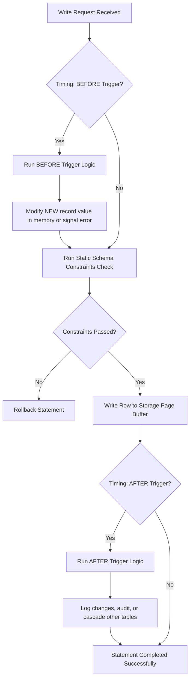

# Master Class: Database Triggers (Déclencheurs)

**Course Context:** Bases de Données Avancées (Master 1)
**Sources:** *Source 20 (SQL Procedural), Source 18 (Gestion de l'intégrité), Source 15 (Corrigé TD4)*

---

## Part 1: Theoretical Foundations

### 1.1 What is a Trigger?
According to **Source 18 (Slide 43)** and **Source 20 (Section 4.1)**, a Trigger (Déclencheur) is a specialized stored procedure that is **automatically executed** (fired) by the DBMS in response to a specific event on a table.

Unlike standard procedures, **you never call a trigger manually**. It waits for an event to happen.

### 1.2 The Event Model (ECA Rule)
Triggers follow the **Event-Condition-Action** logic:
1.  **Event:** A modification command: `INSERT`, `UPDATE`, or `DELETE`.
2.  **Timing:** When to fire? `BEFORE` the modification hits the disk, or `AFTER` it is confirmed.
3.  **Condition (optional):** An optional logic check — either a `WHEN` clause on the trigger definition or an `IF` statement inside the trigger body — that determines whether the trigger's main logic should run.
4.  **Action:** The SQL code to execute (validation, auditing, calculation).

### 1.3 Key Variables: `NEW` and `OLD`
Inside a trigger, you have access to two "pseudo-rows" that hold the data involved in the transaction (**Source 20, Section 4.4**):

| Pseudo-row | Description | Available In |
| :--- | :--- | :--- |
| **`NEW`** | The new version of the row being inserted or updated. | `INSERT`, `UPDATE` |
| **`OLD`** | The original version of the row before modification. | `UPDATE`, `DELETE` |

> [!TIP] Access Syntax
> You access columns using dot notation: `NEW.column_name` or `OLD.column_name`.
> Attempting to read or modify `OLD` during an `INSERT` statement, or `NEW` during a `DELETE` statement, will cause a compilation or runtime error.

---

## Part 2: Syntax and Creation

### 2.1 The Standard Structure
Based on **Source 20 (Section 4.4)**:

```sql
CREATE TRIGGER TriggerName
{ BEFORE | AFTER } { INSERT | UPDATE | DELETE }
ON TableName
FOR EACH ROW
BEGIN
    -- Business Logic
    -- Use NEW.col and OLD.col here
END;
```

### 2.2 BEFORE vs. AFTER
*   **BEFORE:**
    *   Fires *before* the integrity checks and the physical write.
    *   **Use case:** Data validation, data cleaning (formatting), blocking invalid transactions.
    *   *Power:* You can change `NEW.value` here to fix data silently.
*   **AFTER:**
    *   Fires *after* the operation is successful.
    *   **Use case:** Logging (Audit), updating related tables (denormalization), cascading changes.
    *   *Limitation:* You cannot change `NEW.value` here (it's already written).

The full execution pipeline, showing where each timing runs relative to the static schema constraint check and the storage buffer write:



### 2.3 Statement-Level vs. Row-Level Triggers (`FOR EACH ROW`)
Triggers can run at two different scopes:
*   **Row-Level Triggers (`FOR EACH ROW`)**:
    If a single `UPDATE` statement modifies 500 rows, a row-level trigger will execute 500 separate times—once for each individual row. This is the only type of trigger that has access to the `NEW` and `OLD` variables, making it necessary for row-by-row validation.
*   **Statement-Level Triggers**:
    If an `UPDATE` statement modifies 500 rows, a statement-level trigger will run exactly once. This trigger cannot access row-specific `NEW` or `OLD` context variables. It is typically used to validate broad transaction rules, run administrative tasks, or check lock patterns.

---

## Part 3: Use Cases & Scenarios (Dynamic Integrity)

**Source 18 (Slide 41)** defines triggers as "Dynamic Integrity Constraints". They are used where static constraints (like `CHECK` or `FOREIGN KEY`) are not enough.

### 3.1 Complex Validation
*   *Static:* `CHECK (age > 18)`
*   *Dynamic (Trigger):* "A pilot cannot be promoted to 'Captain' unless they have flown 1000 hours." (Requires logic).

### 3.2 Denormalization Maintenance
*   If you store a `Total_Sales` column in a `Store` table (for performance), you need a trigger on the `Sales` table to update that total every time a sale is made.

```sql
CREATE TRIGGER sync_category_product_count
AFTER INSERT ON Products
FOR EACH ROW
BEGIN
    UPDATE Product_Categories
    SET Active_Product_Count = Active_Product_Count + 1
    WHERE ID = NEW.CategoryID;
END;
```

### 3.3 Auditing
*   Recording who changed what and when into a `Logs` table.

```sql
CREATE TRIGGER audit_deleted_employees
AFTER DELETE ON Employees
FOR EACH ROW
BEGIN
    INSERT INTO Audits_Log (Table_Name, Record_Key, Operation, Altered_By, Timestamp)
    VALUES ('Employees', OLD.ID, 'DELETE', CURRENT_USER, NOW());
END;
```

---

## Part 4: Solved Exercises (Deep Dive)

The following exercises are from **TD N°4 (MySQL Procedural)** and demonstrate advanced trigger logic.

**Context Schema:**
*   `Pilote (brevet, nom, nbHVol, comp, nbqualif, grade)`
    *   *Columns:* `brevet` (License ID - PK), `nom` (Name), `nbHVol` (Flight Hours), `comp` (Airline Code), `nbqualif` (Count of active qualifications), `grade` (Pilot Rank)
*   `Qualifications (brevet, typa, dateexpiration)`
    *   *Columns:* `brevet` (License ID - FK), `typa` (Aircraft Type - Composite PK), `dateexpiration` (Expiration Date)

### Exercise 7: Automatic Counter Decrement (`AFTER DELETE`)
**Scenario:** The table `Pilote` has a column `nbqualif` which stores the count of qualifications a pilot holds. We must ensure this number stays accurate when a qualification is deleted.

**Solution:**
```sql
DELIMITER $

DROP TRIGGER IF EXISTS TrigDelQualif $

CREATE TRIGGER TrigDelQualif
AFTER DELETE ON Qualifications
FOR EACH ROW
BEGIN
    -- Logic: Find the pilot who owned this qualification and decrease their count
    UPDATE Pilote 
    SET nbqualif = COALESCE(nbqualif, 1) - 1
    WHERE brevet = OLD.brevet;
END $

DELIMITER ;
```
**Reasoning:**
1.  **Timing:** `AFTER` is appropriate because we only want to update the count if the deletion actually succeeded.
2.  **Event:** `DELETE`.
3.  **Reference:** We use `OLD.brevet` because the row in `Qualifications` is being removed; we need the ID that *used* to be there.
4.  **Defensive Programming (`COALESCE` + `DROP TRIGGER IF EXISTS`):** If a pilot's `nbqualif` value is `NULL`, subtracting 1 directly would result in `NULL` due to SQL's null propagation rules (`NULL - 1 = NULL`). Using `COALESCE(nbqualif, 1)` ensures that any initial `NULL` safely defaults to a base integer. The leading `DROP TRIGGER IF EXISTS` lets the script be re-run safely during development.

---

### Exercise 8: Automatic Counter Increment (`AFTER INSERT`)
**Scenario:** Conversely, when a new qualification is added, the pilot's count must increase.

**Solution:**
```sql
DELIMITER $

DROP TRIGGER IF EXISTS TrigInsQualif $

CREATE TRIGGER TrigInsQualif
AFTER INSERT ON Qualifications
FOR EACH ROW
BEGIN
    UPDATE Pilote 
    SET nbqualif = COALESCE(nbqualif, 0) + 1
    WHERE brevet = NEW.brevet;
END $

DELIMITER ;
```
**Reasoning:**
1.  **Reference:** We use `NEW.brevet` because this is the pilot ID associated with the newly inserted row.
2.  **Null-Handling Strategy (`COALESCE`):** If `nbqualif` starts as `NULL`, `COALESCE` defaults it to `0` and increments it to `1`, preventing `NULL` calculation errors. The leading `DROP TRIGGER IF EXISTS` guarantees clean re-creation.

---

### Exercise 9: Handling Updates (`AFTER UPDATE`)
**Scenario:** What if a qualification is transferred? (e.g., The `brevet` ID in the `Qualifications` table is changed from Pilot A to Pilot B).

**Solution:**
```sql
DELIMITER $

DROP TRIGGER IF EXISTS TrigUpdQualif $

CREATE TRIGGER TrigUpdQualif
AFTER UPDATE ON Qualifications
FOR EACH ROW
BEGIN
    -- Check if the qualification was transferred to a different pilot
    IF (OLD.brevet <> NEW.brevet) THEN
        -- 1. Remove from the old pilot
        UPDATE Pilote 
        SET nbqualif = COALESCE(nbqualif, 1) - 1
        WHERE brevet = OLD.brevet;

        -- 2. Add to the new pilot
        UPDATE Pilote 
        SET nbqualif = COALESCE(nbqualif, 0) + 1
        WHERE brevet = NEW.brevet;
    END IF;
END $

DELIMITER ;
```
**Reasoning:**
*   An `UPDATE` is conceptually a DELETE of the old state and an INSERT of the new state.
*   **Condition Validation Check (`OLD.brevet <> NEW.brevet`):** Without this `IF` block, updating other columns of a qualification row (such as changing the expiration date `dateexpiration`) would trigger unnecessary writes to the `Pilote` table, decrementing and then incrementing the same pilot's counter. Wrapping the logic in an `IF` block ensures updates are only processed when a qualification is actually transferred between pilots.
*   If the brevets are different, the counts are adjusted correctly for both pilots, with `COALESCE` guarding against `NULL` counters (`NULL - 1 = NULL`, `NULL + 1 = NULL`).

---

### Exercise 10: Complex Data Correction (`BEFORE INSERT`)
**Scenario:** Enforce strict business rules for Pilot Grades based on flight hours (`nbHVol`).
*   **Rules:**
    *   `CDB`: Must have 1000-4000 hours.
    *   `COPI`: Must have 100-1000 hours.
    *   `INST`: Must have > 3000 hours.
*   **Requirement:** If the data inserted is invalid (e.g., a novice listed as 'CDB'), force the grade to `NULL` (or correct it) instead of crashing.

**Solution:**
```sql
DELIMITER $

DROP TRIGGER IF EXISTS TrigInsGrade $

CREATE TRIGGER TrigInsGrade
BEFORE INSERT ON Pilote
FOR EACH ROW
BEGIN
    -- Rule 1: Validate Commander (CDB)
    IF NEW.grade = 'CDB' AND (NEW.nbHVol NOT BETWEEN 1000 AND 4000 OR NEW.nbHVol IS NULL) THEN
        SET NEW.grade = NULL; 
        -- Logic: "You claimed to be CDB but don't have the hours (or none declared). Rejected."
    END IF;

    -- Rule 2: Validate Copilot (COPI)
    IF NEW.grade = 'COPI' AND (NEW.nbHVol NOT BETWEEN 100 AND 1000 OR NEW.nbHVol IS NULL) THEN
        SET NEW.grade = NULL;
    END IF;

    -- Rule 3: Validate Instructor (INST)
    IF NEW.grade = 'INST' AND (NEW.nbHVol < 3000 OR NEW.nbHVol IS NULL) THEN
        SET NEW.grade = NULL;
    END IF;
END $

DELIMITER ;
```
**Reasoning:**
*   **Timing:** Must be `BEFORE`. We need to intercept the data (`NEW.grade`) and modify it *before* it is written to the database.
*   **Action:** Using `SET NEW.col = val` modifies the data in-flight.
*   **Null-Safety Checking (`OR NEW.nbHVol IS NULL`):** If the insert statement does not specify `nbHVol` (leaving it `NULL`), the database's range evaluation (`NULL < 1000`) would evaluate to `UNKNOWN` in SQL's three-valued logic (3VL), silently letting the row pass. Explicitly checking `OR NEW.nbHVol IS NULL` ensures the trigger handles missing flight hour data safely by forcing the grade to `NULL`.

---

### Exercise 11: Blocking Transactions (`SIGNAL SQLSTATE`)
**Scenario:** A pilot cannot have more than 3 qualifications. If a user tries to insert a 4th, block the transaction.

**Modern Solution (MySQL 5.5+):**
```sql
DELIMITER $

DROP TRIGGER IF EXISTS CheckMaxQualif $

CREATE TRIGGER CheckMaxQualif
BEFORE INSERT ON Qualifications
FOR EACH ROW
BEGIN
    DECLARE current_count INT DEFAULT 0;

    -- Check current status (COALESCE guards against a NULL nbqualif counter)
    SELECT COALESCE(nbqualif, 0) INTO current_count 
    FROM Pilote 
    WHERE brevet = NEW.brevet;

    -- Logic
    IF current_count >= 3 THEN
        SIGNAL SQLSTATE '45000' 
        SET MESSAGE_TEXT = 'Error: This pilot already has 3 qualifications.';
    END IF;
END $

DELIMITER ;
```

**Legacy Solution (Workaround for Older MySQL):**
*From Source 15 (Correction TD4)*
If `SIGNAL` is not available, you must force a standard SQL error, like inserting NULL into a NOT NULL column.
```sql
-- Inside Trigger Body
IF current_count >= 3 THEN
    -- Create a dummy table called 'Trace' with a non-null column
    INSERT INTO TRACE VALUES (NULL); 
    -- This causes a crash, rolling back the transaction.
END IF;
```

---

## Part 5: Managing Triggers

### 5.1 Dropping Triggers
```sql
DROP TRIGGER IF EXISTS TriggerName;
```
> [!NOTE] Dependency
> According to **Source 20**, if you drop a table, all associated triggers are automatically deleted.

### 5.2 Restrictions
1.  **No Transactions:** You cannot explicitly use `START TRANSACTION`, `COMMIT`, or `ROLLBACK` inside a trigger. The trigger becomes part of the transaction that fired it.
2.  **Recursion / Mutating Table Error:** Be careful of updating the same table you are triggering on — when a trigger fires on a table, that table is in a *mutating state* (undergoing modification), and in many database engines a row-level trigger is prohibited from querying or modifying the table it is attached to, since attempting to do so can result in an infinite execution loop or a deadlock. Though MySQL handles some cases, infinite loops are still possible (Update T1 -> Trigger Updates T1 -> Trigger Updates T1...):

```mermaid
flowchart TD
    A[Update Row in Table A] --> B[Trigger on Table A Fires]
    B --> C[Trigger updates Table A]
    C --> B
    Note over B,C: Infinite Recursion Stack Overflow / Locked Session
```

---

## Summary Checklist for Exams

1.  **NEW vs OLD:**
    *   `INSERT`: Only **NEW**.
    *   `DELETE`: Only **OLD**.
    *   `UPDATE`: Both **NEW** and **OLD**.
2.  **Timing:**
    *   Use **BEFORE** to validate or modify data.
    *   Use **AFTER** to update *other* tables.
3.  **Blocking:** Use `SIGNAL SQLSTATE` to stop an operation.
4.  **Syntax:** Always remember `FOR EACH ROW`.
