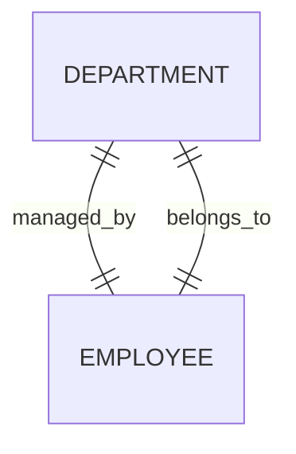
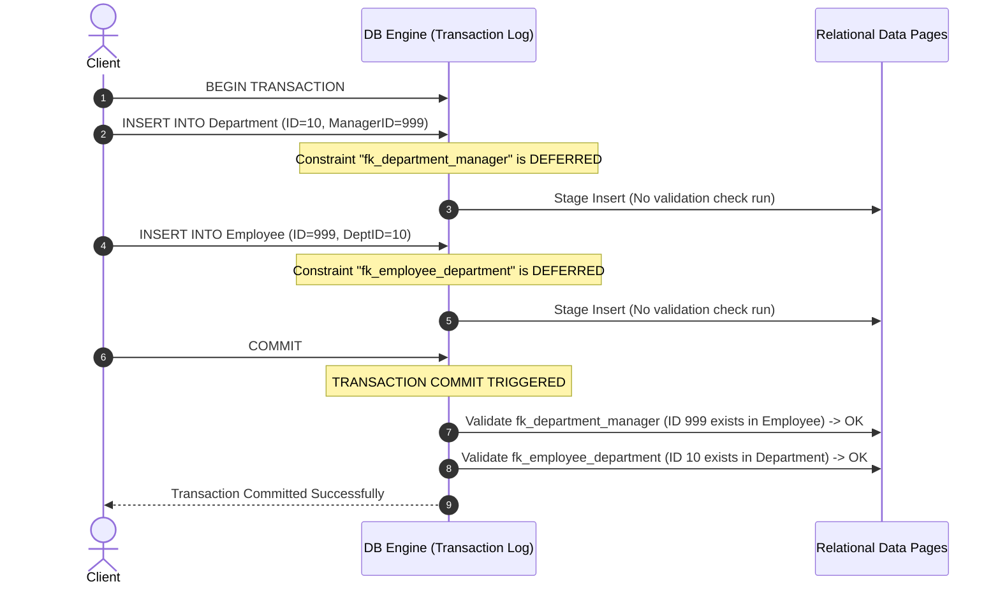

# Assertions and Deferrable Constraints

While basic `CHECK` constraints and `FOREIGN KEY` constraints are excellent for simple rules, they possess limitations. Advanced integrity management involves cross-table constraints and timing deferments.

## 1. Standard Constraints Limitations
A `CHECK` constraint is typically evaluated against a single row in a single table. 
*   *Example:* `CHECK (Salary > 0)`
However, what if the business rule requires data from multiple tables?
*   *Example Rule:* "The total sum of salaries in department 'HR' cannot exceed $1,000,000."
You cannot write a standard `CHECK` constraint for this because it requires aggregating a whole table and potentially joining it with another.

## 2. Assertions (`CREATE ASSERTION`)
An **Assertion** is a standalone, schema-level integrity constraint. It is independent of any specific table and acts as a global rule for the entire database instance.

### Syntax
```sql
CREATE ASSERTION Assertion_Name CHECK ( condition );
```

### Example 1: Manager Salary Hierarchy
Ensure that no employee makes more money than their direct manager:
```sql
CREATE ASSERTION check_salary_hierarchy CHECK (
    NOT EXISTS (
        SELECT 1
        FROM Employee E
        JOIN Manager M ON E.ManagerID = M.ManagerID
        WHERE E.Salary > M.Salary
    )
);
```

### Example 2: Department Budget Cap
A rule like *"The total sum of all employee salaries within the 'Engineering' department must never exceed $2,500,000"* requires calculating a sum across the `Employees` table and joining it with the `Departments` table, so it can only be expressed as an assertion using `GROUP BY` / `HAVING`:

```sql
CREATE ASSERTION check_department_budget CHECK (
    NOT EXISTS (
        SELECT D.ID
        FROM Departments D
        JOIN Employees E ON D.ID = E.DeptID
        GROUP BY D.ID, D.Budget
        HAVING SUM(E.Salary) > D.Budget
    )
);
```

> [!WARNING] Performance Costs
> While part of the SQL standard, many modern DBMS (like MySQL and PostgreSQL) **do not support** `ASSERTION` natively because evaluating a global subquery on every `INSERT`/`UPDATE` across the whole database causes severe performance bottlenecks. 
> *Modern Workaround:* Developers use a combination of database **Triggers** or explicit transactional validation inside **Stored Procedures** to simulate Assertions.

## 3. Deferrable Constraints
By default, the DBMS checks integrity constraints **immediately** at the end of every individual SQL statement. If an `INSERT` violates a Foreign Key, the statement fails instantly.

### The Cyclic Dependency Problem
Imagine two tables, `Department` and `Employee`.



*   `Department` has a Foreign Key `ManagerID` referencing `Employee(ID)`. (Every department must have a manager).
*   `Employee` has a Foreign Key `DeptID` referencing `Department(ID)`. (Every employee must belong to a department).

How do you create a new Department and its Manager at the same time? 
1. If you insert the Department first, it fails because the Manager doesn't exist yet.
2. If you insert the Manager first, it fails because the Department doesn't exist yet.

### The Solution: `DEFERRABLE`
You can tell the database to wait. Instead of checking constraints after every *Operation*, it waits and checks them at the end of the *Transaction* (`COMMIT`).

### Mode Configurations
When creating the constraint, you attach deferrable properties:
1.  **`NOT DEFERRABLE`:** The default. Checked immediately.
2.  **`DEFERRABLE INITIALLY IMMEDIATE`:** Can be deferred dynamically during a session, but acts immediately by default.
3.  **`DEFERRABLE INITIALLY DEFERRED`:** Checked only at the `COMMIT` of the transaction.

### Example Solution
```sql
-- Step 1: Define the Employee Table
CREATE TABLE Employee (
    ID INT PRIMARY KEY,
    Name VARCHAR(100),
    DeptID INT
);

-- Step 2: Define the Department Table with a Deferrable Foreign Key
CREATE TABLE Department (
    ID INT PRIMARY KEY,
    Name VARCHAR(100),
    ManagerID INT,
    CONSTRAINT fk_department_manager FOREIGN KEY (ManagerID) REFERENCES Employee(ID)
    DEFERRABLE INITIALLY DEFERRED
);

-- Step 3: Add the back-link constraint to Employee
ALTER TABLE Employee
ADD CONSTRAINT fk_employee_department FOREIGN KEY (DeptID) REFERENCES Department(ID)
DEFERRABLE INITIALLY DEFERRED;
```

Now, the transaction works:
```sql
BEGIN TRAN;
-- These temporarily violate constraints, but the DB allows it:
INSERT INTO Department (ID, Name, ManagerID) VALUES (10, 'IT', 99);
INSERT INTO Employee (ID, Name, DeptID) VALUES (99, 'Alice', 10);
-- The DB finally checks constraints here. Since both exist now, it succeeds!
COMMIT; 
```

### Execution Mechanics of Deferred Constraint Verification
At `COMMIT`, the database engine runs the constraint validation checks for both deferred foreign keys — because both referencing keys now exist, validation passes and the write is finalized:


