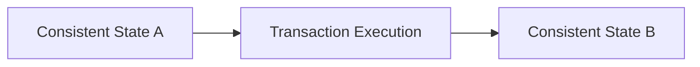
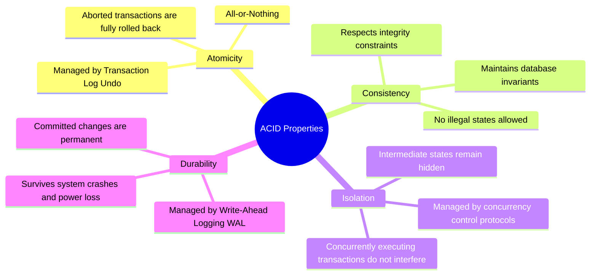
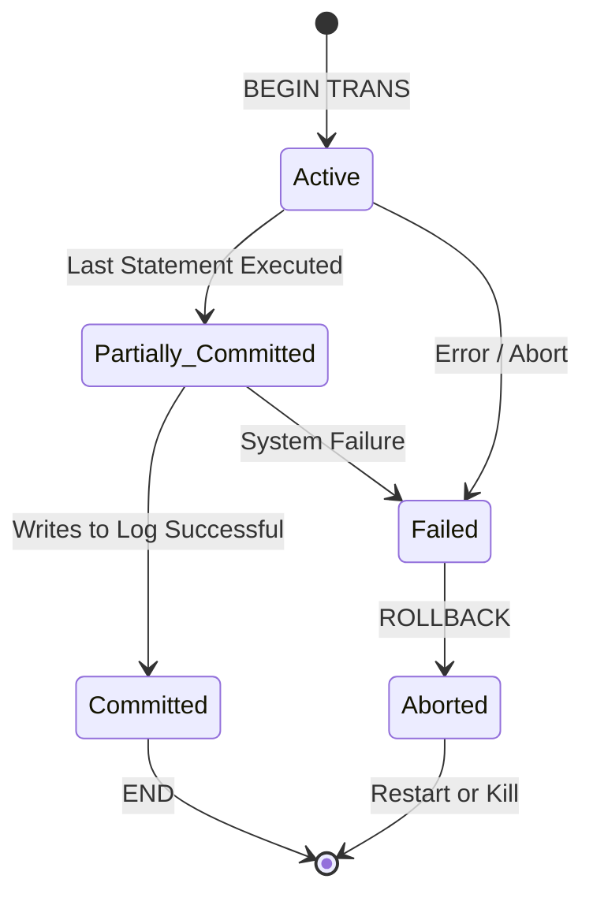

# ACID Properties & Transaction States

## 1. What is a Transaction?
A transaction is a **Logical Unit of Work (LUW)**. It is not merely an isolated query; it is a sequence of database operations (DML, such as `INSERT`, `UPDATE`, `DELETE`) treated as a single, indivisible execution block. Its primary goal is to transition the database from one consistent state to another consistent state.

## 2. The ACID Rules
Every DBMS transaction *must* guarantee these four properties:

### **A - Atomicity**
*   **Concept:** "All or Nothing".
*   **Explanation:** Either all operations in the transaction succeed, or none of them happen.
*   **Failure handling:** If an error occurs halfway, the DB performs a **ROLLBACK** to undo partial changes.
*   **Mechanism:** The DBMS tracks uncommitted changes in memory and log files; when an abort occurs, it reads these logs in reverse to restore the original values.
*   **Failure Example:** During a bank transfer, account $A$ is successfully debited, but a network disconnect prevents account $B$ from being credited. Atomicity guarantees that the debit on $A$ is undone, preventing money from vanishing.

### **C - Consistency**
*   **Concept:** "Valid Data Only".
*   **Explanation:** A transaction must transform the database from one valid state to another valid state. It must obey all **Integrity Constraints**.
*   **Invariants Checked:**
    *   **Schema Constraints:** Primary keys, foreign keys, unique indexes, and `CHECK` constraints.
    *   **Application-Level Constraints:** Invariants not explicitly declared in the DDL, such as "the sum of all balances in a banking ledger must remain constant during a transfer."
*   **Example:** In a bank transfer, `Sum(Accounts)` must be the same before and after the transaction. Money cannot disappear.
*   **Failure Example:** If a constraint dictates that a pilot's flight hours cannot be negative, any transaction attempting to write a negative value will be rejected, forcing a rollback to preserve consistency.

### **I - Isolation**
*   **Concept:** "Private Execution".
*   **Explanation:** The intermediate state of a transaction is invisible to other transactions.
*   **Mechanism:** Achieved using locking protocols, multi-version concurrency control (MVCC), or serialization graphs, preventing parallel transactions from reading partial or inconsistent modifications.
*   **Failure Example:** If Transaction 1 updates a customer's address but has not yet committed, Transaction 2 must not read the new address. If Transaction 1 subsequently aborts, Transaction 2 would have processed invalid data.
*   **Implementation:** Achieved via **Locking** (See [[02 Concurrency Control and Isolation]]).

### **D - Durability**
*   **Concept:** "Written in Stone".
*   **Explanation:** Once a user receives a "Success" (COMMIT) message, the data is permanently saved, even if the power fails 1 millisecond later.
*   **Implementation:** Achieved via **Write-Ahead Logging (WAL)** — the transaction log is synchronized to non-volatile storage (disk-write synchronization or flash writes) before returning a success signal to the application.
*   **Failure Example:** A user receives a "Transfer Complete" notification. One millisecond later, the database server loses power. Upon reboot, the database must recover the transfer data because the commit was acknowledged.

---

## 3. Transaction States Diagram
Understanding the lifecycle of a transaction is key for debugging.

During its lifecycle, a transaction moves through several distinct execution states:

1.  **Active:** The initial state of any transaction. It enters this state when execution begins, and remains here while running its DML statements (`SELECT`, `INSERT`, `UPDATE`, `DELETE`).
2.  **Partially Committed:** This state is reached after the final statement of the transaction has been executed, but before the changes are safely written to disk. The data resides in volatile memory buffers (RAM).
3.  **Committed:** The transaction successfully transitions to this state once all log records representing its modifications—including the final `COMMIT` log entry—have been flushed to non-volatile storage (disk). At this point, durability is guaranteed, and the transaction is complete.
4.  **Failed:** A transaction enters this state if an error is detected during execution (e.g., a constraint violation, deadlock, or disk failure) or if it is aborted while in the active or partially committed states.
5.  **Aborted:** The state reached after the database has finished reversing all modifications made by a failed transaction. The database is restored to its exact pre-transaction state, and any locks held by the transaction are released.

> [!NOTE] Key Distinction
> *   **Partially Committed:** The instructions are done, but the data might still be only in RAM (not safe yet).
> *   **Committed:** The Log has been written to disk. Durability is guaranteed.
