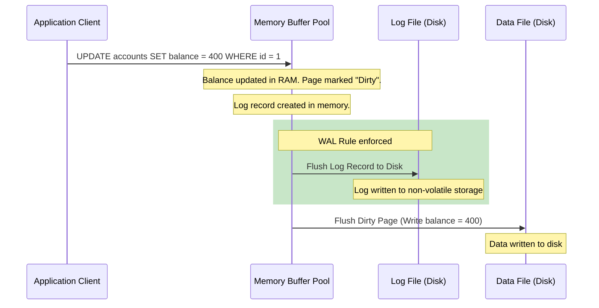
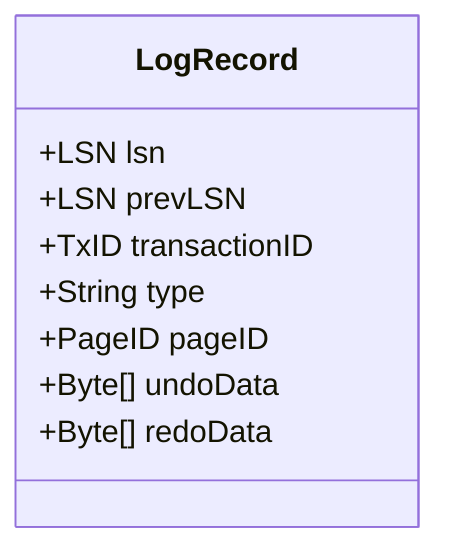
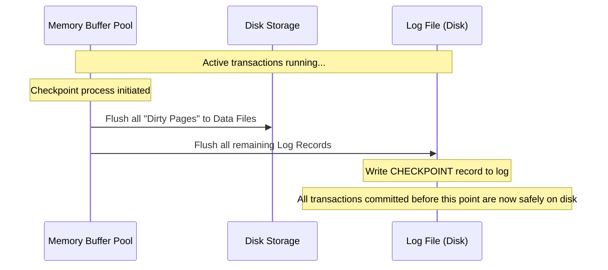

# Crash Recovery

How does the database survive a power failure? To ensure **Durability** and **Atomicity**, a database must be able to recover from crashes (such as power losses or system failures) and restore the database to a consistent state on reboot.

## 1. Buffer Pool Management Policies (STEAL / NO-STEAL, FORCE / NO-FORCE)

The database engine manages data in memory (RAM) using a **Buffer Pool** before writing it to physical storage. The recovery engine's design depends on two key buffer management decisions: **Steal** and **Force**.

```mermaid
grid
  row
    col
      %% Column for STEAL/NO-STEAL
      html "<b>Steal Policy (Uncommitted RAM Flushes)</b>"
      html "<br>Can uncommitted data frames be written to disk?"
      html "<ul><li><b>STEAL:</b> Yes. Offers better RAM utilization but requires an <b>UNDO</b> phase during recovery to reverse changes from aborted transactions.</li><li><b>NO-STEAL:</b> No. Simplifies recovery but limits performance because dirty pages must be kept in RAM until commit.</li></ul>"
    col
      %% Column for FORCE/NO-FORCE
      html "<b>Force Policy (Commit Flushing)</b>"
      html "<br>Must all updated pages be written to disk immediately upon commit?"
      html "<ul><li><b>FORCE:</b> Yes. Slows down transaction processing because of random disk writes.</li><li><b>NO-FORCE:</b> No. Commits are logged instantly, and data pages are written to disk in batches. Requires a <b>REDO</b> phase during recovery.</li></ul>"
```

To maximize performance, modern high-performance database engines use a **STEAL / NO-FORCE** policy. Because this policy allows uncommitted changes on disk and committed changes to remain in volatile memory, the recovery engine must support both **UNDO** and **REDO** operations.

## 2. The Log (Journal)

*   **Write-Ahead Logging (WAL):** The DB writes the change to a text log file *before* writing to the actual data file.
*   Sequential writing is fast.
*   **The WAL Rule:** The database must write the log record describing a modification to disk **before** the corresponding data page in the buffer pool is written to disk.
*   **The Commit Rule:** A transaction is not considered committed until its log records—including the final `COMMIT` record—have been safely written to non-volatile storage.



### Log Record Structure

The transaction log is an append-only file containing sequence records. Each log entry is assigned a unique, monotonically increasing **Log Sequence Number (LSN)**.



*   **LSN (Log Sequence Number):** A unique identifier for the log record.
*   **PrevLSN:** A link to the previous log record written by this transaction. This creates a backwards-linked list of records for each transaction, allowing the recovery engine to trace and undo its actions during recovery.
*   **TxID:** The ID of the transaction that performed the modification.
*   **Type:** The type of log record (e.g., `START`, `UPDATE`, `COMMIT`, `ABORT`, or `CLR` - Compensating Log Record used during rollbacks).
*   **PageID:** The identifier of the physical database page that was modified.
*   **Undo Data:** The original values of the modified data (used to reverse changes during an `UNDO` pass).
*   **Redo Data:** The new values of the modified data (used to reapply changes during a `REDO` pass).

## 3. Checkpoints

*   Periodically, the DB saves all memory to disk.
*   Recovery only needs to start from the last Checkpoint, speeding up reboot time.

If a database runs for a long time, its transaction log will grow very large. Scanning the entire log during a recovery process would take too long, delaying database startup. To keep log sizes manageable, the database uses **Checkpoints**:



During a checkpoint, the database:
1.  Flushes all dirty data pages in the buffer pool to disk.
2.  Writes a `CHECKPOINT` record to the log. This record includes a list of all active transactions and dirty pages at the time of the checkpoint.
3.  Flushes all log records to disk.

Any transactions that committed before the checkpoint can be ignored during recovery because their changes are guaranteed to be saved on disk.

## 4. Recovery Process (Simplified ARIES Style)

When a database restarts after a crash, the recovery manager scans the log and performs a three-phase recovery process to restore database consistency.

```mermaid
graph TD
    A[Database Crash] --> B[1. Analysis Phase]
    B -->|Identify active transactions & dirty pages| C[2. REDO Phase (Roll Forward)]
    C -->|Replay all changes from oldest uncommitted write| D[3. UNDO Phase (Roll Back)]
    D -->|Reverse uncommitted transactions| E[Consistent Database Restored]
```

1.  **Analysis Phase:**
    *   Scans the log forward starting from the last checkpoint.
    *   Identifies all active transactions (transactions without a `COMMIT` or `ABORT` record) and dirty pages at the time of the crash.
2.  **REDO Phase (Roll Forward):**
    *   Replays all log records starting from the oldest unwritten page identified during the analysis phase.
    *   This "repeats history," reapplying changes for both committed and uncommitted transactions to restore the database to its exact state at the moment of the crash.
3.  **UNDO Phase (Roll Back):**
    *   Scans the log backward from the crash point to reverse the changes of all transactions that were active (uncommitted) at the time of the crash.
    *   For each reversed operation, the recovery manager writes a **Compensating Log Record (CLR)** to ensure the rollback itself can survive subsequent crashes.
