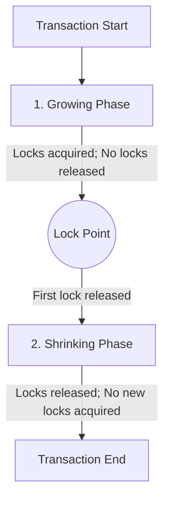
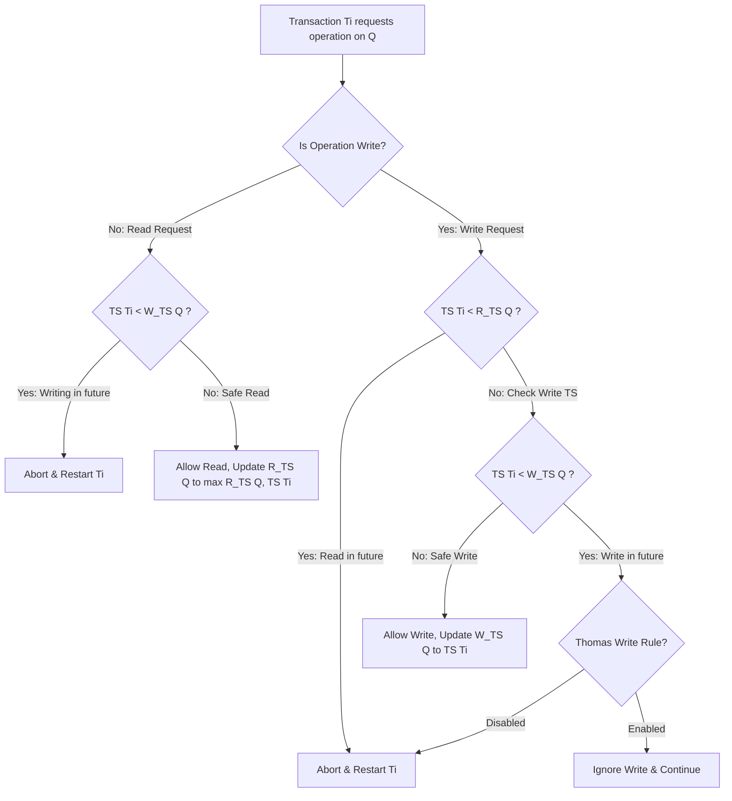
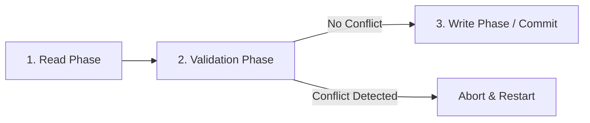
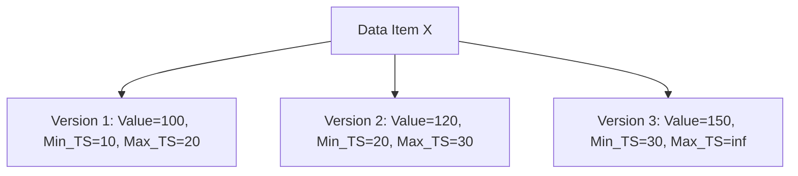
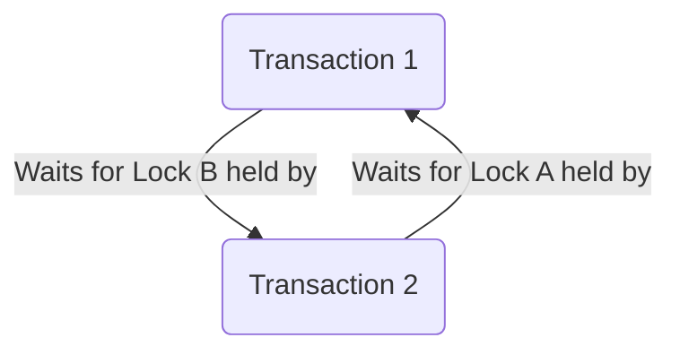

# Advanced Concurrency Protocols

While SQL Isolation Levels (Read Committed, Serializable) tell the DBMS *what* anomalies to prevent, **Concurrency Control Protocols** define *how* the engine actually achieves this internally.

There are two primary paradigms: **Pessimistic** (Locking, assuming conflicts will happen) and **Optimistic** (Versioning, assuming conflicts are rare).

## 1. Lock-Based Protocols (Pessimistic)
Before reading or writing a data item, a transaction must acquire a lock.

### Types of Locks
*   **Shared Lock (S-Lock):** Required for reading. Multiple transactions can hold S-locks on the same data simultaneously.
*   **Exclusive Lock (X-Lock):** Required for writing/updating. Only **one** transaction can hold an X-lock at a time. It blocks all other S-locks and X-locks.

**Lock Compatibility Matrix:**

| Lock Requested | Shared (S) | Exclusive (X) |
| :--- | :---: | :---: |
| **Shared (S) Held** | **Granted (Compatible)** | Blocked (Incompatible) |
| **Exclusive (X) Held** | Blocked (Incompatible) | Blocked (Incompatible) |

### Two-Phase Locking (2PL)
To guarantee "Serializability" (the highest isolation level resulting in math strictly equivalent to executing transactions one by one), the DBMS uses the **2PL protocol**. 
A transaction is divided into exactly two phases:
1.  **Growing Phase:** The transaction requests and acquires locks. It *cannot release* any lock.
2.  **Shrinking Phase:** The transaction begins releasing locks. Once it releases its first lock, it *cannot acquire* any new locks.



The **Lock Point** marks the boundary between the two phases: the moment the transaction has acquired its final lock (end of the growing phase) before it releases its first lock.

**The Problem with Basic 2PL:** It can lead to **Cascading Rollbacks**. If Trans A releases an X-lock during its shrinking phase, Trans B might read it. If Trans A then crashes and rolls back, Trans B has read "dirty" data and must also be rolled back.

### Strict 2PL (S2PL)
To fix cascading rollbacks, databases use Strict 2PL.
*   **Rule:** A transaction obeys basic 2PL, but it **holds all Exclusive (X) locks until the very end** (`COMMIT` or `ROLLBACK`). It does not release them gradually. 

### Rigid / Strong Strict 2PL (SS2PL)
The most restrictive variation. It requires transactions to hold **both Shared (S) and Exclusive (X) locks** until the transaction completes (`COMMIT` or `ROLLBACK`). This guarantees that transactions can be serialized in the order they commit.

## 2. Timestamp Ordering Protocol (TO)
This is a non-locking protocol. Instead of waiting for locks, the system assigns a **Timestamp (TS)** to every transaction when it starts. 

Every piece of data (row or block) keeps track of two timestamps (denoted $R\_TS(Q)$ and $W\_TS(Q)$ below):
*   `Read_TS(Q)` — $R\_TS(Q)$: The timestamp of the youngest transaction that successfully read Q.
*   `Write_TS(Q)` — $W\_TS(Q)$: The timestamp of the youngest transaction that successfully wrote Q.

### The Algorithm Rule
When Transaction $T_i$ issues a command, the DBMS compares $T_i$'s timestamp against the data's timestamps.
*   **Rule of thumb:** "You cannot mess with the future." If a transaction from the "future" (a higher timestamp) has already read or written the data, the older transaction $T_i$ is too late. It is aborted and restarted with a new timestamp.

#### Read Protocol for Transaction $T_i$ on Data Item $Q$
*   If $TS(T_i) < W\_TS(Q)$, it means a younger transaction (which should be ordered after $T_i$) has already updated $Q$. This would result in $T_i$ reading an inconsistent, "future" value.
    *   **Action:** Abort $T_i$ and restart it with a new timestamp.
*   If $TS(T_i) \ge W\_TS(Q)$, the read is safe.
    *   **Action:** Execute the read. Set $R\_TS(Q) = \max(R\_TS(Q), TS(T_i))$.

#### Write Protocol for Transaction $T_i$ on Data Item $Q$
*   If $TS(T_i) < R\_TS(Q)$, it means a younger transaction has already read $Q$'s value. If $T_i$ were to update $Q$ now, that younger transaction would have read an outdated value, violating serializability.
    *   **Action:** Abort $T_i$ and restart it.
*   If $TS(T_i) < W\_TS(Q)$, it means a younger transaction has already updated $Q$. This write operation is trying to overwrite a newer value with an older one.
    *   **Action:** Under the standard protocol, abort $T_i$. Under the **Thomas Write Rule** optimization, this write is simply ignored, and the transaction is allowed to continue. This is safe because the younger transaction's write would have overwritten $T_i$'s write anyway.
*   If neither condition is met, the write is safe.
    *   **Action:** Execute the write. Set $W\_TS(Q) = TS(T_i)$.

**Decision Flowchart:**



**Advantages of TO:** No locks mean **Deadlocks are impossible**.
**Disadvantages:** High abort/restart rates in heavily contested environments. 

## 3. Optimistic Concurrency Control (OCC)
In environments where conflicts are very rare (e.g., mostly reading data, like a Wiki or an analytics dashboard), managing locks is a waste of CPU. OCC assumes everything will be fine.

OCC has three phases for a transaction:



1.  **Read & Execute Phase:** The transaction reads data without taking any locks. It performs its updates on a *private local copy* in RAM.
2.  **Validation Phase:** When the transaction attempts to `COMMIT`, the DBMS checks if any other transaction modified the data while we were working.
    *   *Backward Validation:* Compares the transaction's read set against the write sets of recently committed transactions.
    *   *Forward Validation:* Compares the transaction's write set against the read sets of currently active transactions.
3.  **Write Phase:** If validation succeeds, the private local changes are copied to the actual database on disk. If it fails, the transaction is discarded (rolled back).

> [!INFO] MVCC (Multi-Version Concurrency Control)
> Modern DBMS like PostgreSQL heavily use MVCC. When you update a row, it doesn't overwrite it. It creates a *new version* of the row. This allows readers to read the old version without being blocked by writers taking X-locks, elegantly solving many concurrency bottlenecks.

## 4. Multi-Version Concurrency Control (MVCC) — Version Chains in Detail



*   **Mechanism:** When a transaction updates a data item, the database does not overwrite the existing value. Instead, it creates a new, timestamped version of that item (each version carries a `Min_TS` / `Max_TS` validity interval).
*   **Reads (Snapshot Reads):** When a transaction reads a data item, the database determines which version of the item was current when the transaction started (its start timestamp). The transaction reads this historical version, ensuring a consistent view of the data without needing to acquire locks.
*   **Writes:** Write operations create new versions of data items. These new versions are not visible to older, currently running transactions, preventing conflicts.
*   **Garbage Collection:** A background process periodically removes old versions of data items that are no longer needed by any active transactions.

## 5. Deadlocks (Interblocage)

A deadlock occurs when two or more transactions are blocked because each is waiting for a lock held by another. This creates a cycle of dependency where no transaction can proceed.



To resolve deadlocks, databases use two main strategies: **Prevention** and **Detection & Resolution**.

### A. Deadlock Prevention (Timestamp-Based)

Deadlock prevention schemes use transaction timestamps to decide which transaction should wait or abort when a lock conflict occurs.

*   **Wait-Die (Non-Preemptive Scheme):**
    *   If an older transaction $T_{old}$ requests a lock held by a younger transaction $T_{young}$: $T_{old}$ is allowed to **wait**.
    *   If $T_{young}$ requests a lock held by $T_{old}$: $T_{young}$ is forced to abort and release its locks (**dies**).
*   **Wound-Wait (Preemptive Scheme):**
    *   If $T_{old}$ requests a lock held by $T_{young}$: $T_{old}$ aborts $T_{young}$ (**wounds** it) and takes the lock.
    *   If $T_{young}$ requests a lock held by $T_{old}$: $T_{young}$ is allowed to **wait**.

### B. Deadlock Detection and Resolution

Instead of trying to prevent deadlocks, this strategy allows them to occur, detects them using background processes, and resolves them.

```mermaid
graph TD
    subgraph Wait-For Graph (WFG)
    T1((T1)) -->|Waits for lock held by| T2((T2))
    T2 -->|Waits for lock held by| T3((T3))
    T3 -->|Waits for lock held by| T1
    end
    
    style T1 fill:#f9f,stroke:#333,stroke-width:2px
    style T2 fill:#f9f,stroke:#333,stroke-width:2px
    style T3 fill:#f9f,stroke:#333,stroke-width:2px
```

*   **Wait-For Graph (WFG):** The DBMS maintains a directed graph where nodes represent active transactions, and edges represent wait conditions (e.g., $T_1 \to T_2$ means $T_1$ is waiting for a lock held by $T_2$).
*   **Detection Cycle:** A background process periodically checks this graph for cycles. Any cycle indicates a deadlock.
*   **Resolution (Victim Selection):** Once a deadlock is detected, the DBMS breaks the cycle by selecting a "victim" transaction to abort and roll back.
    *   *Victim Selection Criteria:* The database considers several factors to minimize recovery costs, including transaction age, the number of updates performed, and the number of locks held.
