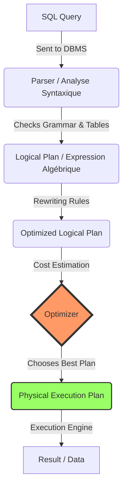

# 1. Query Processing Architecture

## Overview

When you write a SQL query, you are writing **Declarative Code**. You tell the database _what_ you want (e.g., "Give me the names of clients who live in Paris"), but you do not tell it _how_ to get it (e.g., "Open file A, read line 1, check if city is Paris...").

The **Query Optimizer** is the brain of the SGBD (DBMS) that translates your "What" into the most efficient "How".

## The Lifecycle of a Query

The process of executing a SQL query follows a specific pipeline.

### The Stages Explained

1.  **Parser (Analyse Syntaxique & Sémantique):**
    - **Syntax:** Is the SQL written correctly? (e.g., is "SELEC" misspelled?). A syntax error immediately terminates execution; a valid query produces a **Parse Tree**.
    - **Semantics:** The parse tree is validated against the database schema catalog:
        - **Relation and Attribute Existence:** Do these tables and columns actually exist in the database?
        - **Data Type Compatibility:** Are the operations performed on compatible data types (e.g., comparing an integer column with a date)?
        - **Security and Authorization:** Does the user have permission (privileges like `SELECT`, `UPDATE`) to see them?
    - _Output:_ A parse tree.

2.  **Logical Plan (Traduction Algébrique):**
    - The query is converted into **Relational Algebra**.
    - Example: `SELECT * FROM T WHERE A=5` becomes $\sigma_{A=5}(T)$.
    - This is an **Initial Logical Plan** (often the "naive" or unoptimized version). It directly mimics the written structure of the SQL statement (Selection $\sigma$, Projection $\pi$, Join $\bowtie$ nodes over base tables) without any performance-based optimizations.

3.  **Query Rewrite & Transformation Engine:**
    - Before any cost calculations are made, the optimizer restructures the logical plan using algebraic rewrite rules, applying heuristics to simplify operations and reduce the size of intermediate data sets:
    - Simplifying boolean expressions (e.g., rewriting `WHERE 1=1 AND status = 'Active'` to `WHERE status = 'Active'`).
    - Simplifying (unnesting) subqueries into joins where possible.
    - Pushing selections ($\sigma$) and projections ($\pi$) as deep as possible down the tree.

4.  **Optimization (The Critical Step - The Cost-Based Optimizer):**
    - The database generates many equivalent plans (different ways to do the same thing).
    - It uses **Heuristics** (rules of thumb, e.g., "filter early") and **Cost Estimation** (math based on table size) to pick the winner.
    - The **Cost-Based Optimizer (CBO)** evaluates multiple physical execution alternatives for the logical plan based on:
        - **Physical Access Paths:** Should the engine perform a Sequential Scan, an Index Scan, or a RowID lookup?
        - **Physical Join Algorithms:** Should it employ a Nested Loop Join, a Sort-Merge Join, or a Hash Join?
        - **Database Statistics:** Catalog metadata regarding table sizes, column cardinalities, and value distributions.
    - The cost metric represents the estimated execution time, heavily dominated by the number of **Disk I/O Operations** (page reads and writes) and, to a lesser extent, CPU cycles.

5.  **Physical Plan:**
    - The logical steps are mapped to specific algorithms (e.g., "Use Index Scan" vs "Use Table Scan", "Use Hash Join" vs "Nested Loop").
    - The optimizer selects the physical plan with the lowest estimated cost, and the **Execution Engine** steps through it, pulling data blocks from disk or the buffer pool, processing the rows through the designated physical operators, and returning the final result set to the client.

---

**Procedural Parsing and Delimiters:** Defining procedural schema objects (stored procedures, triggers, functions) requires temporarily changing the statement delimiter (`DELIMITER //` in MySQL) because the object body itself contains internal semicolons — see [[07 Delimiters and Procedural Parsing Mechanics]] for the full mechanics.

> [!TIP] Student Tip
> In exams, you are often asked to transform a SQL query into a "Canonical Tree" (the raw translation) and then an "Optimized Tree". The canonical tree usually looks exactly like the structure of the SQL query (Select at top, From at bottom), which is often inefficient.
