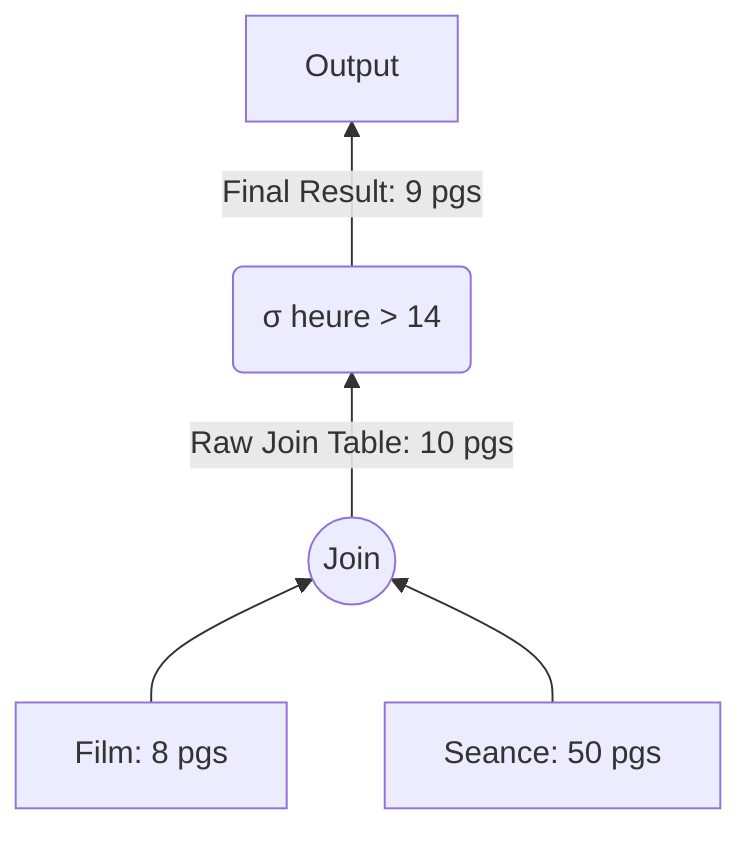
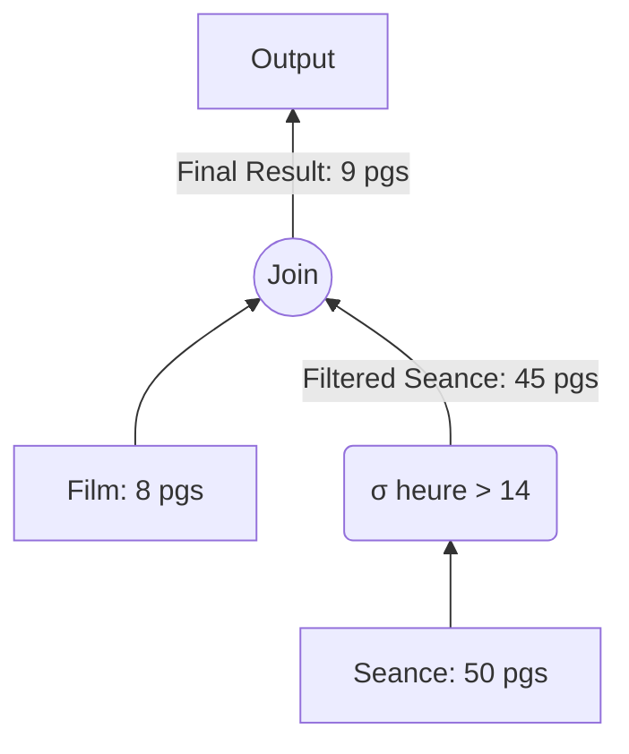

# 7. The Rare Case Where Optimization Fails Mathematical Proof

A crucial and counter-intuitive concept in Query Optimization is that the "Golden Rule" (always pushing Selections down before Joins) is **not universally correct**. The slides showcase a specific mathematical proof of this edge case, which requires a rigorous breakdown.

## 1. Defining the Variables (E/S - Entrées/Sorties)
The cost model uses `E/S` (Input/Output operations). 
*   **`E` (Reads):** Fetching a page from the hard drive into RAM.
*   **`S` (Writes):** Writing a temporary intermediate result back to the RAM or disk.

## 2. The Setup
Consider two relations, `Film` and `Seance`:
*   **$P_{Film}$ (Size of `Film`):** $8$ pages on disk.
*   **$P_{Seance}$ (Size of `Seance`):** $50$ pages on disk.
*   **$Sel(\text{heure} > 14)$ (Selectivity of the selection on `Seance`):** $0.90$. This means $90\%$ of the sessions happen after 14h, leaving the filtered table highly populated.
*   **$Sel(\text{Join})$ (Join Selectivity):** $0.20$. Only $20\%$ of the rows matched during the Join actually survive to create the new combined table.

We assume that writing a page of an intermediate result to disk/buffer memory is an expensive operation ($S$), and we compare the total cost of two physical execution plans.

## 3. Plan A: The Naive Plan (Join First, Filter Later)

1.  **The Join:** We perform a Block Nested Loop Join. We read all 8 pages of `Film`. For each page, we read all 50 pages of `Seance`.
    *   **Read Cost ($E_{A1}$):** 
        $$ E_{A1} = 8 \times 50 = 400 \text{ reads} $$
    *   **Write Cost ($S_{A1}$):** The join combines 50 total pages, but only 20% survive the join. It eliminates $80\%$ of the data immediately:
        $$ 50 \text{ pages} \times 0.20 = 10 \text{ pages written} $$
        $$ S_{A1} = 10 \text{ writes} $$
    *   *Subtotal Cost:* $400E + 10S$
2.  **The Selection:** We scan the new 10-page temporary table to filter for `heure > 14`.
    *   **Read Cost ($E_{A2}$):** We read the 10 temporary pages:
        $$ E_{A2} = 10 \text{ reads} $$
    *   **Write Cost ($S_{A2}$):** 90% of the rows survive the filter:
        $$ 10 \text{ pages} \times 0.90 = 9 \text{ pages written} $$
        $$ S_{A2} = 9 \text{ writes} $$
    *   *Subtotal Cost:* $10E + 9S$

**Total Cost for Plan A:** 
$$ \text{Total Cost}_A = (E_{A1} + E_{A2}) + (S_{A1} + S_{A2}) = (400 + 10)E + (10 + 9)S = 410E + 19S $$
$$ \text{Total Cost}_A = 410 + 19 = \mathbf{429 \text{ I/O operations}} $$

## 4. Plan B: The "Optimized" Plan (Filter First, Join Later)

1.  **The Selection:** We filter `Seance` first.
    *   **Read Cost ($E_{B1}$):** We read all 50 pages of `Seance`:
        $$ E_{B1} = 50 \text{ reads} $$
    *   **Write Cost ($S_{B1}$):** Because the selectivity is low (90% of rows survive the filter), the size of the filtered intermediate table is:
        $$ 50 \text{ pages} \times 0.90 = 45 \text{ pages written} $$
        $$ S_{B1} = 45 \text{ writes} $$
    *   *Subtotal Cost:* $50E + 45S$
2.  **The Join:** We now join `Film` (8 pages) with the new temporary filtered `Seance` table (45 pages).
    *   **Read Cost ($E_{B2}$):** 
        $$ E_{B2} = 8 \text{ pages} \times 45 \text{ pages} = 360 \text{ reads} $$
    *   **Write Cost ($S_{B2}$):** The join selectivity is 20%:
        $$ 45 \text{ pages} \times 0.20 = 9 \text{ pages written} $$
        $$ S_{B2} = 9 \text{ writes} $$
    *   *Subtotal Cost:* $360E + 9S$

**Total Cost for Plan B:** 
$$ \text{Total Cost}_B = (E_{B1} + E_{B2}) + (S_{B1} + S_{B2}) = (50 + 360)E + (45 + 9)S = 410E + 54S $$
$$ \text{Total Cost}_B = 410 + 54 = \mathbf{464 \text{ I/O operations}} $$

## 5. Why Did the Optimization Fail?

Comparing the two plans:
*   **Plan A (Join First):** $429$ I/O operations.
*   **Plan B (Filter First):** $464$ I/O operations.

The "optimized" plan is **35 E/S more expensive** than the naive plan! 

**The Reason:** 
1.  **The Write Penalty ($S$):** By forcing the database to filter `Seance` first, we forced it to write a massive 45-page temporary table into memory ($45S$). Writing data ($S$) is generally more expensive than reading data ($E$).
2.  **The Join as a Filter:** In Plan A, the Join destroyed 80% of the data immediately (highly selective join). By doing the highly restrictive Join *first*, the intermediate data was instantly crushed down to 10 pages, meaning the subsequent filter had almost no work to do.

> [!important] The Optimization Heuristic Rule Exception
> You should always push selections down **unless** the Join operator is significantly more selective (destroys more data) than the Selection operator, and the cost of writing the intermediate filtered table outweighs the read savings of the join.
> Formally, do not push selections down the query tree if:
> 1. The selection filter has low selectivity (it filters out very few rows).
> 2. The join operator is highly restrictive (it filters out a large percentage of rows).
> 3. The write cost ($S$) of storing the filtered intermediate relation is larger than the read savings achieved by joining a smaller table.
