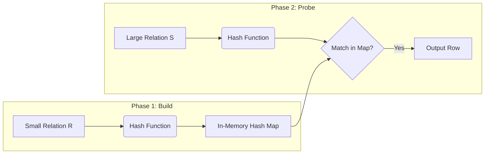

# 8. Join Algorithms Pseudocode and Memory Complexity

The physical algorithms chosen by the database engine to execute a `JOIN` determine whether a query finishes in milliseconds or crashes the server. We must map the algebraic operators to physical computing mechanics.

## 1. Simple Nested Loop Join (Boucles Imbriquées Simples)
This is the brute-force algorithm. It uses two `FOR` loops.

**Pseudocode:**
```text
J := Ø
FOR EACH row r IN outer_table R DO:
    FOR EACH row s IN inner_table S DO:
        IF r.key == s.key THEN
            J := J U {r + s}
        END IF
    END FOR
END FOR
RETURN J
```

*   **Complexity:** $O(N \times M)$
*   **Memory Requirement:** Extremely low $O(1)$. It only needs enough RAM to hold one row of `R` and one row of `S` at a time.
*   **Flaw:** If table S is large, the disk head will thrash, scanning table S entirely from disk $N$ times.

## 2. Index Nested Loop Join (Par Index)
A massive optimization over the simple nested loop. The inner loop does not scan the whole table; it queries a B-Tree index.

**Pseudocode:**
```text
J := Ø
FOR EACH row r IN outer_table R DO:
    -- Instead of a loop, do an $O(log M)$ B-Tree lookup
    s_rows := Index_Search(S, r.key) 
    FOR EACH s IN s_rows DO:
        J := J U {r + s}
    END FOR
END FOR
```

*   **Complexity:** $O(N \times \log M)$
*   **I/O Disk Cost:** $P_R + (N_R \times \text{Cost of Index Lookup})$ — reading the outer relation's pages ($P_R$) plus one index lookup per outer row ($N_R$).
*   **Memory Requirement:** Low.
*   **Advantage:** This is the preferred algorithm when joining a massive table to a very small table, assuming the massive table has an index on the join column.

## 3. Sort-Merge Join (Tri-Fusion)
This algorithm assumes both tables are sorted by the join key. It walks down both tables simultaneously, advancing pointers based on the values.

**Pseudocode:**
```text
Sort(R, key)
Sort(S, key)
r_idx := 0, s_idx := 0
N_R := length(R), N_S := length(S)

WHILE r_idx < N_R AND s_idx < N_S DO:
    IF R[r_idx].key == S[s_idx].key THEN
        -- Handle matches and duplicates
        match_start_s := s_idx
        WHILE r_idx < N_R AND R[r_idx].key == S[match_start_s].key DO:
            s_idx := match_start_s
            WHILE s_idx < N_S AND R[r_idx].key == S[s_idx].key DO:
                J := J ∪ { R[r_idx] || S[s_idx] }
                s_idx++
            END WHILE
            r_idx++
        END WHILE
    ELSE IF R[r_idx].key < S[s_idx].key THEN
        r_idx++
    ELSE
        s_idx++
    END IF
END WHILE
RETURN J
```

*   **Complexity:** $O(N \log N + M \log M)$ for the sorting phase, plus $O(N + M)$ for the merge phase.
*   **I/O Disk Cost:** $P_R + P_S$ once the tables are sorted.
*   **Memory Requirement:** Requires enough RAM buffer to sort the tables (or writes temporary sorting files to disk).
*   **Advantage:** Extremely efficient if the tables are already sorted via clustered indexes.
*   **Duplicates note:** The nested `match_start_s` loops handle duplicate join keys correctly — every R row with key $k$ is paired with _every_ S row with the same key $k$ (the inner pointer rewinds to `match_start_s` for each R duplicate).

## 4. Hash Join (Par Hachage)
The standard for modern large-scale analytics. It builds an in-memory dictionary and works in two distinct phases:



**Pseudocode:**
```text
J := Ø
hash_table := NewHashTable()

-- Phase 1: Build Phase
FOR EACH row r IN R DO:
    hash_bucket := hash(r.key)
    hash_table.insert(hash_bucket, r)
END FOR

-- Phase 2: Probe Phase
FOR EACH row s IN S DO:
    hash_bucket := hash(s.key)
    IF hash_table.contains(hash_bucket) THEN
        FOR EACH matching_row r IN hash_table.get(hash_bucket) DO:
            IF r.key == s.key THEN
                J := J ∪ { r || s }
            END IF
        END FOR
    END IF
END FOR
RETURN J
```

*   **Complexity:** $O(N + M)$ (Linear time!).
*   **Collision correctness:** Rows are inserted into *buckets* (`hash_table.insert(hash_bucket, r)`) instead of overwriting a single slot per hash value, and the probe phase re-checks exact key equality (`IF r.key == s.key`). Two different keys that hash to the same bucket are therefore not incorrectly joined.
*   **Memory Requirement:** The database *must* have enough RAM to fit the entire hash table of the smaller table `R`. If the RAM is exhausted, it spills the partition buckets to disk (a **Grace Hash Join**), which increases the overall I/O cost to approximately $3 \times (P_R + P_S)$ and destroys performance.
*   **Rule:** The Query Optimizer always chooses the significantly smaller table to be the "Build" table (outer loop) to ensure it fits in memory.
