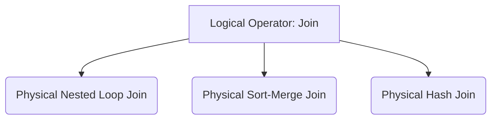

# 3. Physical Operators & Algorithms

Once the logical plan is decided, the DBMS must decide _how_ to execute it physically. This involves choosing access paths and algorithms. Each logical operator can be translated into several concrete physical algorithms:



## 1. Access Paths (How to read data)

### A. Sequential Scan (Table Scan)

- **Mechanism:** Reads every single block/page of the table from disk.
- **When to use:** When the table is small, or when you need to read a large percentage (>15-20%) of the rows.
- **Cost:** Proportional to the total number of pages in the table.

### B. Index Scan

- **Mechanism:** Uses a B-Tree or Hash Index to find pointers to the specific rows, then fetches those rows.
- **When to use:** When looking for a specific value (e.g., `WHERE ID = 500`) or a small range.
- **Cost:** Proportional to the depth of the tree + number of matching records.

### C. Index-Only Scan (Covering Index)

- **Mechanism:** If the index structure contains **all the columns requested by the query**, the engine can return the data directly from the index.
- **Advantage:** This avoids the extra step of reading the actual table pages from disk (the RowID lookups are skipped entirely).

## 2. Join Algorithms (How to combine tables)

The choice of join algorithm drastically affects performance.

### A. Nested Loop Join (Boucles Imbriquées)

- **Concept:** For every row in the Outer Table (R), scan the entire Inner Table (S).
- **Complexity:** $O(N \times M)$
- **Best for:** Small tables.
- **Visual:**
  ```mermaid
  graph LR
  Outer[Row from Table A] -->|Check every row| Inner[Table B]
  ```

### B. Sort-Merge Join (Tri-Fusion)

- **Concept:** Sort both tables by the join key first. Then, iterate through both lists simultaneously (like zipping a zipper).
- **Complexity:** Cost of Sorting + $O(N + M)$.
- **Best for:** Large tables where the join key is already sorted (e.g., clustered index) or when the output needs to be sorted.

### C. Hash Join (Hachage)

- **Concept:** Create a Hash Map (in memory) of the smaller table. Then scan the larger table and probe the hash map for matches.
- **Complexity:** $O(N + M)$ (Assuming the hash table fits in memory).
- **Best for:** Large, unsorted tables. Usually the fastest for massive data equality joins.

---

## 3. Execution Strategies: Pipelining vs. Materialization

When executing a multi-step physical plan, the engine can pass intermediate results between operators in one of two ways:

### Materialization

Each operator in the execution tree must run to completion, writing its entire intermediate result to a temporary table on disk before passing it to the next step.
-   **Disadvantage:** High I/O overhead due to constant disk writes and reads. (Slow, but safe for low memory.)
-   **When it is used:** Necessary for **blocking operators** like `SORT` or `GROUP BY` that require seeing the entire dataset before producing the first output row.

### Pipelining (The Iterator / Volcano Model)

The system processes data using a streaming model, typically implementing the **Iterator (Volcano) Model**. The result of one operator is passed immediately to the parent operator row-by-row. Each physical operator exposes an interface with three primary methods:
1.  `open()`: Initializes the operator and prepares its state.
2.  `next()`: Processes and returns a single matching tuple. It pulls data from its child operators on demand, passing rows up the execution tree one by one without writing intermediate results to disk.
3.  `close()`: Cleans up resources once all data has been read.

```text
           [Project Operator]  <-- pulls row via next()
                  ^
                  |
            [Join Operator]     <-- pulls row via next()
                  ^
                  |
           [Filter Operator]   <-- pulls row via next()
```

-   **Advantages:** Minimizes memory consumption and eliminates disk I/O for intermediate steps. **Optimized trees usually rely on pipelining.**
-   **When it is used:** The preferred execution strategy for non-blocking operations like Selections and Projections.
