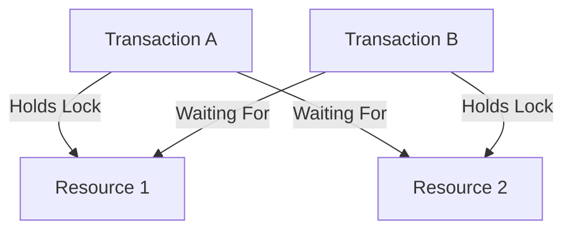

# Advanced Physical Design & Tuning

## 1. Join Algorithms

The Algebra symbol $\bowtie$ is logical. Physically, the DB engine must choose an algorithm to execute it.

| Algorithm            | Best Used When...                                                           | Complexity                   |
| :------------------- | :-------------------------------------------------------------------------- | :--------------------------- |
| **Nested Loop Join** | One table is very small.                                                    | $O(N \times M)$ (worst case) |
| **Hash Join**        | Both tables are large and unsorted. Used for Equi-Joins ($=$).              | $O(N + M)$ (average)         |
| **Merge Join**       | Both tables are **sorted** on the join key (e.g., Joining on Primary Keys). | $O(N + M)$ (fastest)         |

## 2. Indexing Heuristics

Indexes are data structures (B-Trees) that speed up data retrieval ($\sigma$).

- **Selectivity:** Create indexes on columns with high selectivity (columns that verify `WHERE` conditions for very few rows, like `ID` or `Email`).
- **Avoid Over-indexing:** Every `INSERT/UPDATE` requires updating the index. Too many indexes slow down writes.
- **Covering Index:** If an index contains all the columns needed for a query, the DB doesn't even need to look at the main table. This is extremely fast.

## 3. Concurrency Control

How the DB handles multiple users at once.

### Pessimistic Locking

- **Shared Lock (S):** For Reading. Others can read, but not write.
- **Exclusive Lock (X):** For Writing. No one else can read or write.
- **Deadlock:** Transaction A holds a lock on Resource 1 and waits for Resource 2, while Transaction B holds a lock on Resource 2 and waits for Resource 1. Neither can proceed.

- _Solution:_ **Wait-Die** or **Wound-Wait** schemes (kill one transaction based on transaction timestamps $TS$ — a **smaller $TS(T_i)$ means an older transaction**):
    - **Wait-Die (Non-preemptive):** If an older transaction ($TS(T_i)$ smaller) requests a lock held by a younger transaction ($TS(T_j)$ larger), $T_i$ is allowed to wait. If a younger transaction requests a lock held by an older transaction, the younger transaction immediately dies (is rolled back and restarted).
    - **Wound-Wait (Preemptive):** If an older transaction requests a lock held by a younger transaction, the older transaction "wounds" (forces a rollback of) the younger transaction. If a younger transaction requests a lock held by an older transaction, the younger transaction is allowed to wait.

### Optimistic / MVCC (Multi-Version Concurrency Control)

- **Concept:** Don't lock rows for readers.
- **Mechanism:** When you update a row, create a new version of it. Readers see the "old" version that existed when their query started.
- **Heuristic:** "Readers do not block Writers, and Writers do not block Readers."
