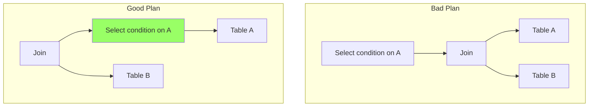
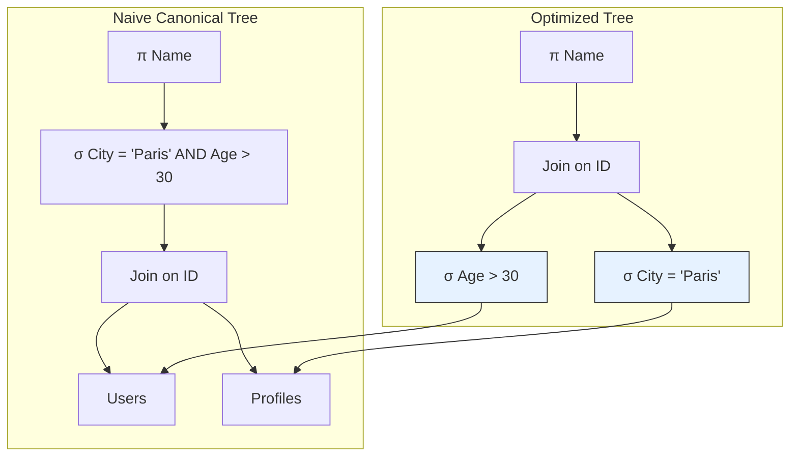

# 4. Optimization Heuristics

Calculating the exact cost of every possible execution plan is impossible (it would take too long). Therefore, databases use **Heuristics**—general rules that almost always result in a better plan.

## The Golden Rules

### 1. Push Selections Down ($\sigma$) - _The Most Important Rule_

**Principle:** Apply filters (`WHERE` clauses) as early as possible (close to the leaves of the tree).
**Why:**

- Reduces the number of rows passed to the next operator.
- Smaller input for Joins = Faster Joins.
- Reduces memory and network usage.

**Visual Transformation:**

**Formal Condition (Commutativity of Selection and Join):** A selection can only be pushed below a join when its predicate references attributes of a _single_ input relation. If the selection predicate $C$ contains only attributes belonging to relation $R$:

$$ \sigma_{C}(R \bowtie S) \equiv (\sigma_{C}(R)) \bowtie S $$

Rather than joining two entire tables and then filtering the resulting large dataset, the selection is applied directly to the base table, reducing the size of the input relation before it ever reaches the expensive join operation.

**Worked Example (splitting a conjunctive predicate onto its tables):**

### 2. Push Projections Down ($\pi$)

**Principle:** Remove columns you don't need as early as possible.
**Why:**

- Reduces the "width" of the tuples (the byte width of each row).
- Saves memory space in the buffer pools.
- Reduces Disk I/O when writing intermediate temporary tables.
- Allows more records (rows) to fit inside a single memory page.
- Reduces I/O bandwidth.
- _Note:_ You must keep the Join Keys even if they aren't in the final output!

**Cascading of Projections:** Successive projections collapse into a single projection containing the final target attribute list $L_1$:

$$ \pi_{L_1}(\pi_{L_2}(R)) \equiv \pi_{L_1}(R) \quad \text{if } L_1 \subseteq L_2 $$

This equivalence only holds when $L_1$ (the final list) is a subset of $L_2$ (the intermediate list).

### 3. Replace Cartesian Products with Joins

**Principle:** Never do a Cross Join ($\times$) followed by a Selection. Use a Join ($\bowtie$) instead.
**Why:**

- $\times$ produces $N \times M$ rows.
- $\bowtie$ produces usually much fewer rows directly.

**Formal Rule:** A Cartesian product followed by a selection condition is always rewritten as a single, explicit inner join:

$$ \sigma_{R.id = S.id}(R \times S) \equiv R \bowtie_{R.id = S.id} S $$

This transformation prevents the engine from generating a massive intermediate Cartesian space, running a direct join instead.

### 4. Join Smallest Relations First

**Principle:** If joining tables A, B, and C, and A is filtered to be very small, join A with B first. More generally, the optimizer orders the operations to join the **smallest or most highly restricted** tables first.
**Why:** It keeps intermediate results small throughout the pipeline.

---

> [!TIP] Student Corner: How to optimize an Algebraic Tree
>
> 1.  **Break apart** complex predicates (e.g., `WHERE A=1 AND B=2` becomes two separate selections).
> 2.  **Slide** the selections down the branches of the tree until they hit the base table they refer to.
> 3.  **Slide** projections down, keeping only necessary columns.
> 4.  **Order** joins so the most restrictive ones happen at the bottom.
