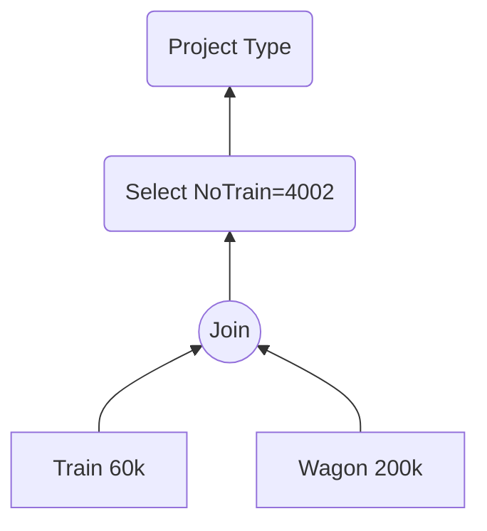
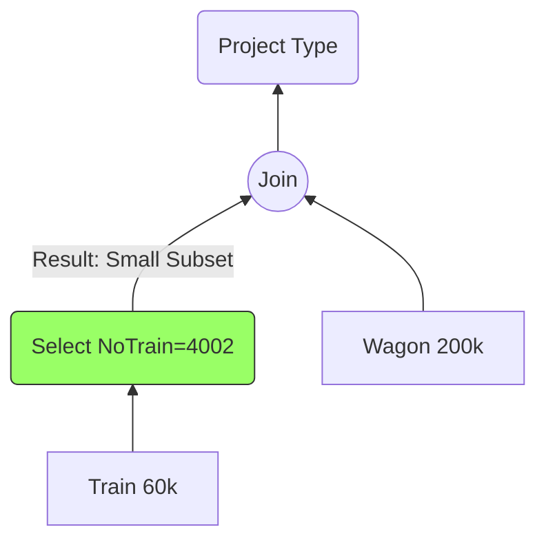

# 6. Exercise Analysis - Trains & Wagons (TD Ex 1)

This exercise demonstrates the concrete application of Heuristic #1 (Push Selections).

## The Context

- **Schema:**
  - `Train(NoTrain, NoWagon)` (Note: The schema in the TD implies a train is a link to wagons).
  - `Wagon(NoWagon, TypeWagon, Status)`
- **Volume:**
  - Trains: $N_{Train} = 60,000$ rows
  - Wagons: $N_{Wagon} = 200,000$ rows
  - Distinct Trains: $V(NoTrain, Train) = 2,000$
  - Page counts: $P_{Train} = 1,200$ pages on disk, $P_{Wagon} = 5,000$ pages on disk.

## The Query

_"Find the type of wagon for Train Number 4002."_

## Tree Comparison

### Tree (a): The "Bad" Tree



- **Analysis:**
  1.  The database builds the **entire** train composition for all 2,000 trains first.
  2.  It creates a massive temporary result containing all wagon assignments.
  3.  Only _then_ does it filter for #4002.
- **Cost:** The join of the entire `Train` table (60,000 rows) with `Wagon` (200,000 rows) yields an intermediate dataset of **60,000 rows** (the complete train compositions). The engine must then perform a full scan of this 60,000-row intermediate dataset to locate the records where `NoTrain = 4002`. This consumes significant CPU, memory, and disk I/O to build and process the large intermediate result — slow execution.

### Tree (b): The "Good" Tree



- **Analysis:**
  1.  The database filters `Train` immediately.
  2.  Under a uniform distribution assumption across the $2,000$ distinct trains, the selection `NoTrain = 4002` outputs:
     $$ \frac{60,000}{2,000} = 30 \text{ rows} $$
     The dataset is instantly reduced from $60,000$ rows down to just $30$ rows.
  3.  The Join now only has to combine those $30$ matching rows with the `Wagon` table: using an index on `Wagon.NoWagon`, the join requires only **30 quick index lookups**.
- **Cost:** Extremely low — milliseconds of execution with minimal CPU and disk I/O. Pushing the selection down achieved a massive performance improvement.

## Detailed Answers to TD Questions

**Q1. Are the trees equivalent?**
**Yes.** The rule of **Commutativity of Selection and Join** applies here.
$$ \sigma_{NoTrain = 4002}(Train \bowtie_{NoWagon} Wagon) \equiv (\sigma_{NoTrain = 4002}(Train)) \bowtie_{NoWagon} Wagon $$

**Proof Steps:**
1.  The selection condition `NoTrain = 4002` references the column `NoTrain`, which belongs exclusively to the `Train` table.
2.  The join condition connects the two tables using the `NoWagon` attribute.
3.  Because the selection condition does not reference any attributes from the `Wagon` table, the filter can be applied directly to the `Train` table before performing the join.
4.  The two algebraic expressions are logically equivalent, ensuring that both plans return the exact same output.

**Q2. Which is better?**
Tree (b) is vastly superior. By reducing the cardinality of the `Train` relation _before_ the join, we minimize the number of comparisons and I/O operations required by the Join operator.

**Q3. SQL Query:**

```sql
SELECT W.TypeWagon
FROM Train T
JOIN Wagon W ON T.NoWagon = W.NoWagon
WHERE T.NoTrain = 4002;
```
