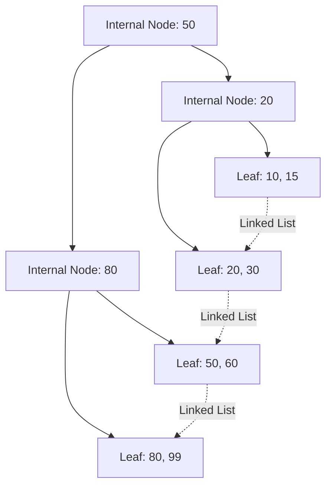

# Database Indexing Deep Dive

While query heuristics dictate the *logical* order of operations, the DBMS relies on **Indexes** to perform the *physical* retrieval. An index is a specialized data structure that takes a search key and quickly returns the physical disk location (Page ID / Slot) of the matching row.

## 1. Primary vs Secondary Indexes
*   **Primary (Clustered) Index:** Determines the physical order of data on the disk. Because data can only be physically sorted one way, a table can only have **one** clustered index (usually the Primary Key). 
    *   *Advantage:* Lightning fast for range queries (`WHERE age BETWEEN 20 AND 30`) because the blocks are contiguous on disk.
*   **Secondary (Non-Clustered) Index:** A separate structure that holds the key and a pointer to the physical row (a **RowID** or Clustered Key). The data is not sorted by this key. You can have multiple secondary indexes.
    *   *Disadvantage:* Range queries using secondary indexes can be slow. Reading non-contiguous pages triggers **random disk I/O**, which is much slower than sequential reads.

## 2. B+ Tree Indexes
The **B+ Tree** is the undisputed king of database indexing. It is a balanced tree specifically designed to minimize disk I/O operations.

### Structure
*   **Internal Nodes:** Contain only keys and pointers to child nodes. They act purely as a navigation roadmap.
*   **Leaf Nodes:** Contain the actual keys and the physical pointers to the database rows (or the data itself in a clustered index). 
    *   *Crucial Feature:* All leaf nodes are linked together in a **doubly-linked list**. This makes traversing sequential ranges completely trivial once you find the starting point.



### Why B+ Trees instead of Binary Search Trees?
A Binary Tree only has 2 children per node. To store 1 million records, the tree is approximately 20 levels deep ($\log_2(1,000,000) \approx 20$). That means 20 disk I/O reads just to find an ID. 
A B+ Tree node matches the size of a disk block (e.g., 8KB) and can branch to hundreds of children. A B+ tree with a fan-out of 100 can store 1 million records in just **3 levels**. This means only 3 disk reads.

More precisely, assuming a page size of **8KB**, a routing key of 8 bytes, and a pointer of 8 bytes, a single internal node can achieve a fan-out of around **500**. Traversing a tree with a fan-out of 500 requires only $\log_{500}(1,000,000) \approx 3$ levels — any record can be located with just **3 disk I/O reads**, significantly reducing execution times.

## 3. Hash Indexes
While B+ Trees are great for range searches (`<`, `>`, `BETWEEN`), Hash Indexes are unbeatable for **exact match equality** (`=`).

A Hash function $h(K)$ converts the search key into a bucket structure. 
*   **Lookup time:** $O(1)$. It finds the data instantly without traversing a tree.
*   **Drawback:** It is absolutely useless for range queries. If you ask `WHERE age > 18`, a hash map cannot help you because 18 and 19 hash to completely random, unrelated buckets. Additionally, hash indexes cannot assist with sorting (`ORDER BY`) or partial string matching (`LIKE 'Sm%'`).

### Static vs Dynamic Hashing
*   **Static Hashing:** The number of buckets is fixed. Problematic for growing databases because it leads to "overflow buckets" (linked lists attached to a bucket), destroying performance and degrading lookups from $O(1)$ towards a slow $O(N)$ sequential search.
*   **Dynamic (Extendible) Hashing:** The hash directory dynamically **doubles or halves in size using a prefix bit-mask** of the hash values. As buckets fill up, the system splits them and updates the directory to point to the new buckets, maintaining $O(1)$ performance regardless of database size.

```text
Directory (Global Depth 2):
 [ 00 ] ----> Bucket A (Local Depth 2): [ 4, 8 ]
 [ 01 ] ----> Bucket B (Local Depth 1): [ 1, 5 ]
 [ 10 ] ----> Bucket C (Local Depth 2): [ 2, 6 ]
 [ 11 ] ----> Bucket B (Local Depth 1) (shared reference)
```

If a bucket overflows, only that specific bucket splits. The directory depth increases (using more prefix bits) without requiring a full re-hash of the entire database, preserving constant-time $O(1)$ lookups as the dataset scales.

## 4. Bitmap Indexes
Used specifically for data with **low cardinality** (columns with very few distinct values, like `Gender`, `Boolean flags`, or `Status`) in read-heavy data warehouses.
Instead of storing pointers, it creates an array of bits ($0$ or $1$) for each value.

```text
Table Data:
Row 0: Gender='M'
Row 1: Gender='F'
Row 2: Gender='M'

Bitmap Index:
Value 'M': [ 1, 0, 1 ]
Value 'F': [ 0, 1, 0 ]
```

*   *Fast aggregations:* `COUNT()` operations can be performed using native bitwise `AND/OR` CPU instructions directly on the bitmaps, bypassing the data completely.
*   *Disadvantage:* Highly inefficient for write-heavy (OLTP) databases. Modifying a single row requires locking the entire bitmap segment, which can block concurrent writes.
