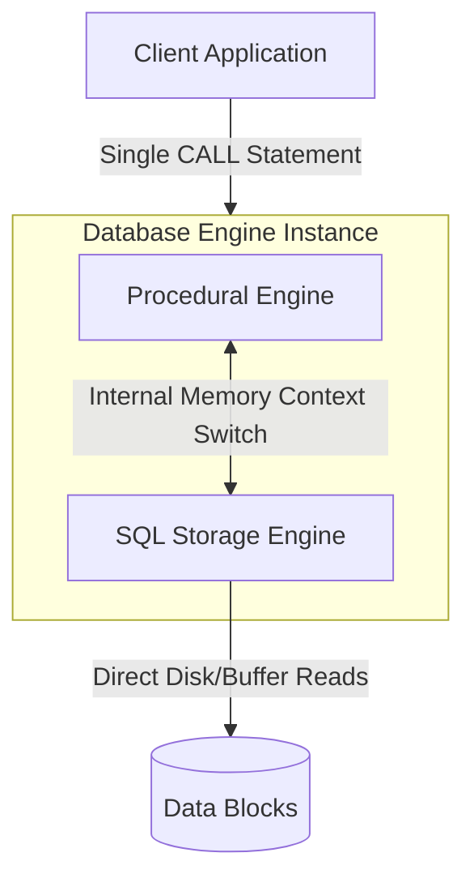

# SQL, PL/SQL, and MySQL Procedural SQL

A Unified Explanation

## What plain SQL can and cannot do

SQL is a **declarative query language**, not a programming language.  
Its purpose is **to describe what data you want**, not how to compute it step-by-step.

SQL **can do**:

- Querying data: `SELECT`
    
- Writing data: `INSERT`, `UPDATE`, `DELETE`
    
- Joins, grouping, filtering
    
- Expressions like `CASE WHEN ... THEN ... END` (but only inside a query)
    

SQL **cannot do**:

- Loops
    
- If/else control flow that affects program execution
    
- Variables
    
- User-defined functions containing procedural logic
    
- Procedures
    
- Error handling
    
- Event-based logic (triggers with flow control)
    
- **High Network Overhead:** without procedural blocks, an application must execute a query, transmit the results over the network to the application server, run the procedural logic in a language like Java or Python, and then send updates back to the database — this causes significant network latency and serialization overhead
    

In short, **SQL alone cannot express algorithms**.

---

# Procedural Extensions: The Engine Architecture

To address these limitations, database engines use procedural extensions. These compile procedural code directly inside the database, executing logic close to the storage engine:



This is what eliminates the High Network Overhead limitation above: the client sends a single `CALL` statement, the procedural engine exchanges data with the SQL storage engine through an internal memory context switch, and data blocks are read directly — results never have to travel to and from the application server.

---

# What PL/SQL is (Oracle)

PL/SQL is Oracle’s **procedural extension** to SQL.  
It adds everything SQL is missing:

- Variables
    
- Conditionals (`IF`, `ELSIF`)
    
- Loops (`WHILE`, `FOR`, `LOOP`)
    
- Functions
    
- Procedures
    
- Packages
    
- Exception handling
    
- Triggers
    
- Complex server-side logic
    

PL/SQL is **Oracle-only**, tightly integrated into the Oracle Database engine. It is a mature, highly structured, proprietary language **modeled on Ada**, featuring compiler optimizations, packages, object-oriented concepts, and robust exception propagation models — it runs within a dedicated engine inside Oracle Database.

---

# Does MySQL have PL/SQL?

No.  
PL/SQL is exclusive to Oracle.

But MySQL has its **own procedural language**, which serves the same purpose:

- Stored procedures
    
- Stored functions
    
- Triggers
    
- Events
    
- Variables
    
- IF / ELSE
    
- WHILE loops
    
- REPEAT loops
    
- LEAVE / ITERATE
    
- CASE statements
    

So MySQL **does support procedural programming**, but with **different syntax and capabilities** from PL/SQL. Formally, MySQL Procedural SQL is a lighter dialect implementing parts of the **SQL/PSM** (Stored Planned Subprograms) standard — it provides the same essential logic controls as Oracle PL/SQL but lacks advanced features like package compilation, custom collection types, and object-oriented features.

---

# Language Capabilities Comparison

| Feature | Standard Declarative SQL | Oracle PL/SQL | MySQL Procedural SQL |
| :--- | :--- | :--- | :--- |
| **Execution Paradigm** | Set-oriented (all at once) | Procedural (row-by-row or set-based) | Procedural (row-by-row or set-based) |
| **Variables & Assignment** | No | Yes (via `DECLARE` or assignment `:=`) | Yes (via `DECLARE` or `SET`) |
| **Conditionals & Loops** | No (only inline `CASE` values) | Yes (`IF`, `ELSIF`, `LOOP`, `WHILE`, `FOR`) | Yes (`IF`, `ELSEIF`, `WHILE`, `LOOP`, `REPEAT`) |
| **Subroutines** | None | Stored Procedures, Functions, Packages | Stored Procedures, Functions, Events |
| **Exception Handling** | None | `EXCEPTION` block with propagation | `DECLARE ... HANDLER FOR ...` |
| **Execution Context** | Client parses/sends statements | Server engine compiles and caches | Server engine compiles and caches |

---

# Side-by-Side Example

A simple loop printed in both languages.

### Oracle PL/SQL

```
DECLARE
    x NUMBER := 0;
BEGIN
    WHILE x < 5 LOOP
        x := x + 1;
        DBMS_OUTPUT.PUT_LINE(x);
    END LOOP;
END;
/
```

### MySQL Procedural SQL

```sql
CREATE PROCEDURE SimpleLoop()
BEGIN
    DECLARE v_counter INT DEFAULT 0;
    
    WHILE v_counter < 5 DO
        SET v_counter = v_counter + 1;
        SELECT CONCAT('Counter: ', v_counter) AS Output;
    END WHILE;
END;
```

> [!WARNING]
> In MySQL, `WHILE` — like every other procedural flow-control statement — is only valid **inside a stored program** (the body of a `CREATE PROCEDURE`, `CREATE FUNCTION`, or `CREATE TRIGGER`). A bare `WHILE` at the client prompt is a syntax error — hence the `CREATE PROCEDURE SimpleLoop()` wrapper above, using a properly `DECLARE`d local variable.

Same idea, different syntax.

---

# Combined Summary

SQL is declarative and cannot handle procedural logic.  
Oracle solves this with **PL/SQL**.  
MySQL solves it with **its own procedural SQL**, not PL/SQL.  
Both allow full programming constructs inside the database, but with distinct syntax and features.