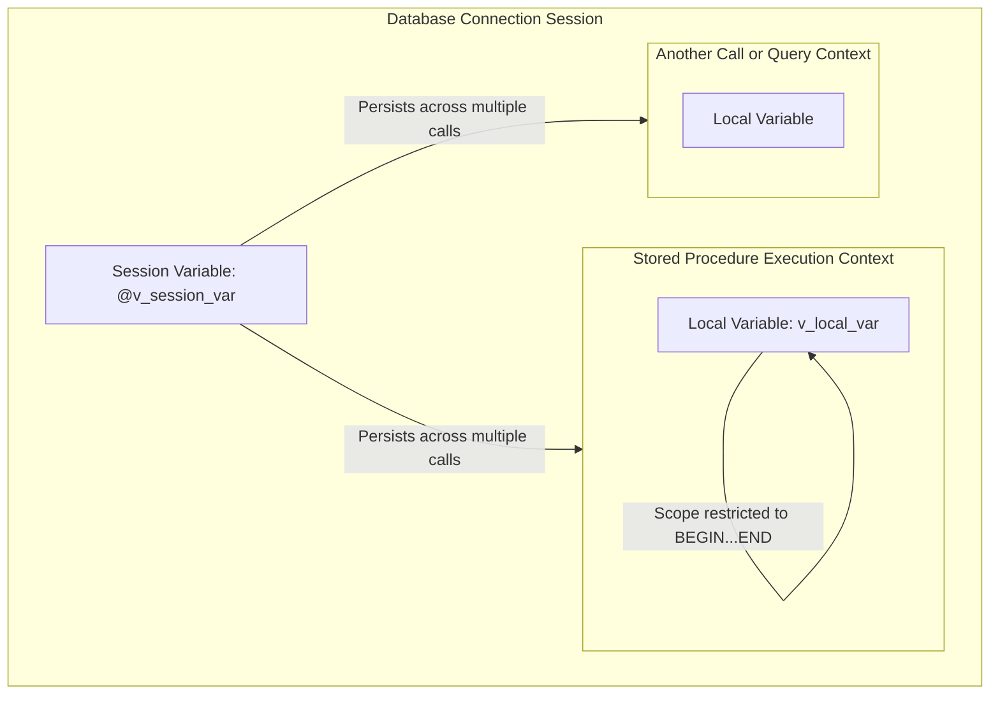
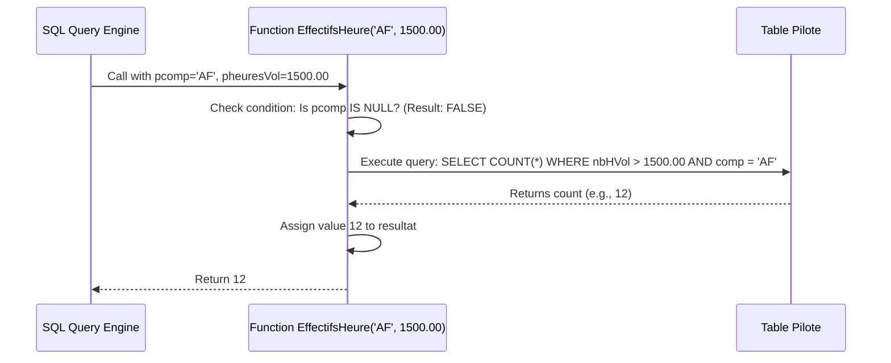
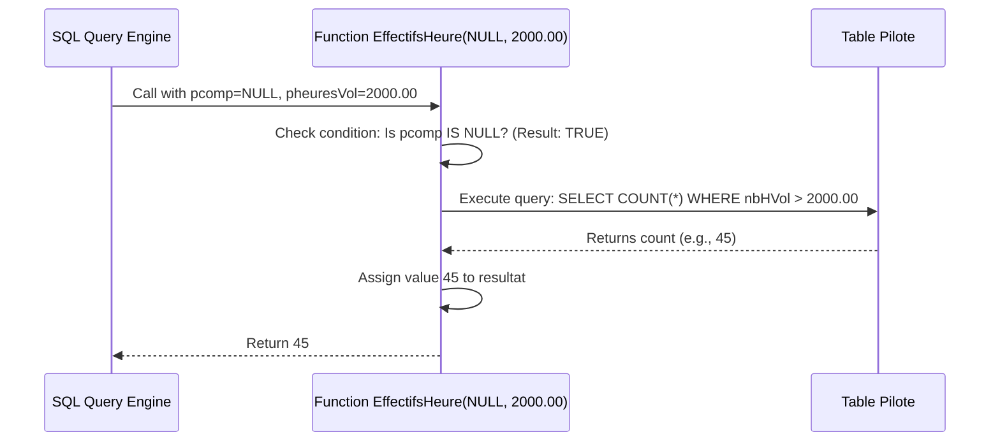
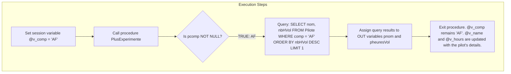
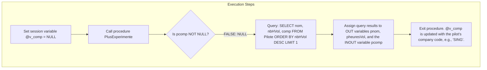
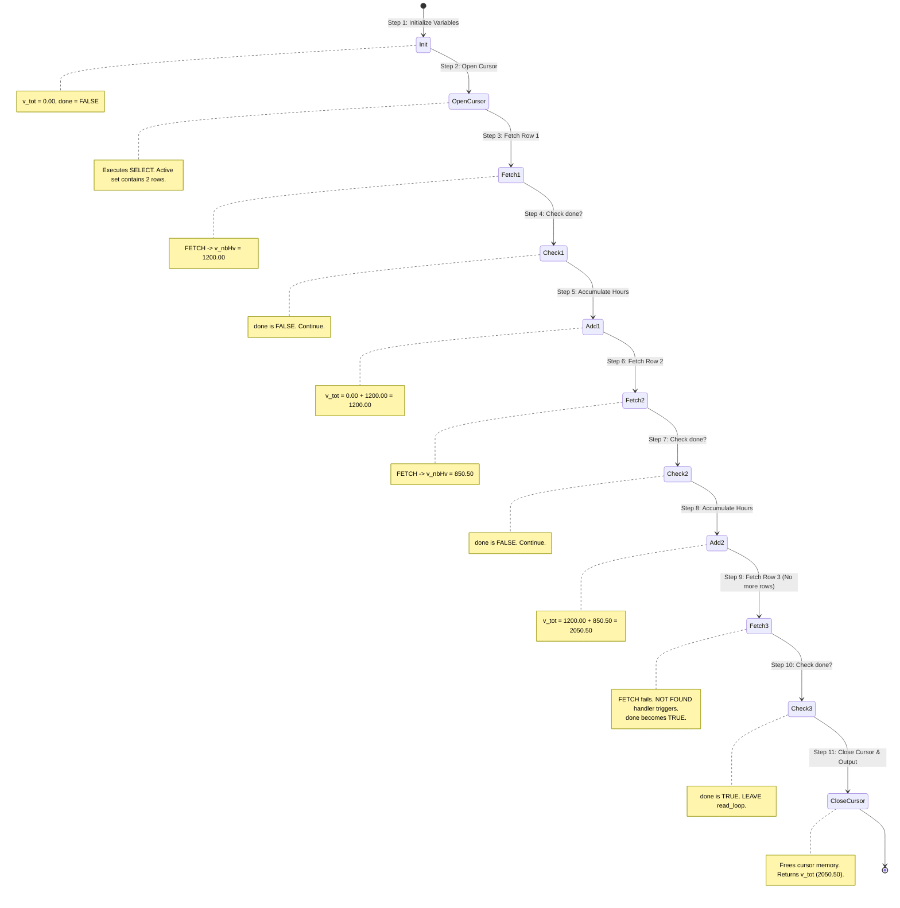
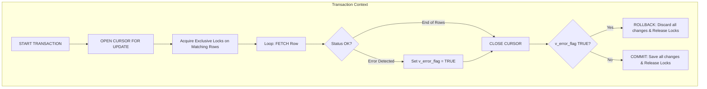

# Master Class: Functions & Stored Procedures (SQL Procedural)

**Course Context:** Bases de Données Avancées (Master 1)
**Sources:** *Source 20 (SQL Procedural), Source 15 (Corrigé TD4)*

---

## Part 1: The Concept of Procedural SQL

### 1.1 Why do we need it?
Standard SQL (`SELECT`, `INSERT`, `UPDATE`) is **Declarative**: you tell the database *what* you want, not *how* to do it step-by-step.
**Procedural SQL** extends SQL by adding programming structures found in languages like C or Java:
*   Variables and assignment.
*   Conditional Logic (`IF`, `CASE`).
*   Loops (`WHILE`, `LOOP`, `REPEAT`).
*   Error Handling (Exceptions).

### 1.2 The "Delimiter" Problem
In standard SQL, the semicolon `;` marks the end of a command.
Inside a procedure, we write many lines of code ending in `;`. To prevent MySQL from executing the procedure halfway through while we are defining it, we must change the delimiter temporarily.

**Standard Pattern:**
```sql
DELIMITER $  -- Change end-marker to $
-- Define the Procedure here
-- Use ; inside the procedure normally
END $        -- End the definition with $
DELIMITER ;  -- Change back to ;
```

---

## Part 2: Variables & Scope

**Source 20 (Section 3)** defines two distinct types of variables. Confusing them is a common exam mistake.

The big picture — a session variable lives at the connection level and persists across calls, while local variables are born and die inside each stored-procedure execution context:



| Property | **Local Variables** (`DECLARE`) | **Session Variables** (`@var`) | **System Variables** (`@@var`) |
| :--- | :--- | :--- | :--- |
| **Scope** | Exist **only** inside the `BEGIN...END` block. | Exist for the entire connection session (globally); invisible to other concurrent sessions. | Global or Session system-wide. |
| **Syntax** | `v_nom` (No @ sign) | `@v_nom` (Must have @) | Must start with `@@` (or use `SET SESSION` / `SET GLOBAL` syntax). |
| **Declaration** | `DECLARE v_nom VARCHAR(20);` — explicit `DECLARE` required. | No declaration needed. Dynamically initialized on first assignment; `NULL` if referenced before that. | Modified via `SET GLOBAL` or `SET SESSION`. |
| **Lifespan** | Duration of the enclosing block. | Duration of the database connection. | Until the instance restarts (unless persisted). |
| **Type Checking** | Strongly and statically typed. | Weakly and dynamically typed — can hold an integer, then be reassigned to a string or date. | Strongly typed. |
| **Default Value** | `NULL` (unless `DEFAULT` is declared). | `NULL`. | Pre-configured by engine defaults. |
| **Usage** | Used for internal calculations. | Used to pass values between procedures or from the shell. | Used to configure engine behavior. |

Local variables are allocated on the thread's execution stack when their block is entered, and automatically reclaimed from memory when execution leaves the block's `END` boundary — they are isolated from concurrent database sessions and from nested outer contexts.

**Nested Scope:** local variables declared inside an inner `BEGIN...END` block vanish at that block's `END` boundary — while the inner block can still read the outer block's variables:

```sql
BEGIN
    DECLARE v_limit INT DEFAULT 100;
    DECLARE v_name VARCHAR(50);
    
    -- Sub-block (nested scope)
    BEGIN
        DECLARE v_nested_score DECIMAL(5,2);
        -- Inner block can access v_limit and v_name
        SET v_nested_score = v_limit * 0.95;
    END;
    -- v_nested_score is no longer accessible here
END;
```

**System Variables (`@@var`)** control the behavior of the database instance itself:
*   **Session System Variables:** configure behaviors for the current connection (e.g., `SET SESSION sql_mode = 'STRICT_TRANS_TABLES';`).
*   **Global System Variables:** configure global behaviors across all connections (e.g., `SET GLOBAL max_connections = 1000;`) — modifying these usually requires administrator privileges.

**Assignment Syntax:**
```sql
SET v_count = 10;
-- OR
SELECT COUNT(*) INTO v_count FROM Pilote;
```

> [!WARNING]
> When using `SELECT ... INTO`, the query **must return exactly one row**. 
> * If the query returns **zero rows**, the database engine raises a `NOT FOUND` exception (SQLSTATE `02000`), terminating execution unless a handler is registered.
> * If the query returns **multiple rows**, the engine raises a `TOOMANYROWS` exception (SQLSTATE `21000`), causing a runtime crash.
> Always use aggregate functions (like `COUNT`, `SUM`) or apply limiting conditions (such as `LIMIT 1` or filtering on primary keys) to guarantee a single-row result.

---

## Part 3: Stored Procedures vs. Functions

**Source 20 (Section 1.3)** outlines the key differences.

### 3.1 Stored Procedures
*   **Purpose:** Execute a series of actions (business logic, updates, complex transactions).
*   **Return Values:** Can return **multiple** values using `OUT` or `INOUT` parameters.
*   **Invocation:** Called using `CALL ProcedureName()`.
*   **Parameter Modes:**
    *   `IN`: Pass value *into* procedure (Read-only inside).
    *   `OUT`: Pass value *out* of procedure (Write-only inside, starts NULL).
    *   `INOUT`: Pass value in, modify it, pass it back out.

**Syntax:**
```sql
CREATE PROCEDURE myProc(IN p_id INT, OUT p_result VARCHAR(50))
BEGIN
    -- Logic
END
```

### 3.2 Stored Functions
*   **Purpose:** Calculate and return a **single value**.
*   **Return Values:** Must have a `RETURNS type` clause and a `RETURN value` statement.
*   **Invocation:** Used inside SQL statements like a variable: `SELECT myFunction(col) FROM Table`.
*   **Restriction:** Generally cannot contain statements that return a result set (like a `SELECT *` without `INTO`).

**Syntax:**
```sql
CREATE FUNCTION myFunc(p_id INT) RETURNS INT
BEGIN
    RETURN p_id * 10;
END
```

---

## Part 4: Cursors (The "Row-by-Row" Processor)

**Source 20 (Section 2)** explains that standard SQL works on *sets* of rows. If you need to process rows one by one (like a `for` loop in Java), you use a **Cursor**.

### The 4-Step Lifecycle
1.  **DECLARE:** Define the query. `DECLARE cur CURSOR FOR SELECT...`
2.  **OPEN:** Execute the query and load results into memory. `OPEN cur;`
3.  **FETCH:** Get the next row into variables. `FETCH cur INTO v_a, v_b;`
4.  **CLOSE:** Free memory. `CLOSE cur;`

> [!TIP] The "Done" Handler
> To stop the loop, you must declare a "Handler". When `FETCH` runs out of rows, MySQL raises a `NOT FOUND` warning. We catch this to set a flag variable to stop the loop.

---

## Part 5: Solved Exercises (Deep Dive)

We will use the **Airline Database** context:
*   `Compagnie (comp, ...)`
*   `Pilote (brevet, nom, nbHVol, comp, ...)`

### Exercise 1: Scalar Function (`EffectifsHeure`)
**Goal:** Return the number of pilots in a company having more than `X` flight hours. If company is NULL, count all pilots.

**Solution:**
```sql
DELIMITER $

CREATE FUNCTION EffectifsHeure(
    pcomp VARCHAR(4),
    pheuresVol DECIMAL(7,2)
) 
RETURNS SMALLINT
DETERMINISTIC READS SQL DATA -- Good practice for function safety
BEGIN
    DECLARE resultat SMALLINT;

    -- Logic: Check if we filter by company or take all
    IF (pcomp IS NULL) THEN
        SELECT COUNT(*) INTO resultat 
        FROM Pilote 
        WHERE nbHVol > pheuresVol;
    ELSE
        SELECT COUNT(*) INTO resultat 
        FROM Pilote 
        WHERE nbHVol > pheuresVol AND comp = pcomp;
    END IF;

    RETURN resultat;
END $
DELIMITER ;
```
**Explanation:**
1.  **`RETURNS SMALLINT`**: Functions must declare the data type they return.
2.  **`SELECT ... INTO`**: We calculate the count and store it immediately in the local variable `resultat`.
3.  **`IF/ELSE`**: Handles the requirement "If comp is NULL, count all".

**Execution Walkthrough — Scenario 1: `SELECT EffectifsHeure('AF', 1500.00);`**



**Execution Walkthrough — Scenario 2: `SELECT EffectifsHeure(NULL, 2000.00);`**



**Key Considerations:**
*   **Handling NULL safely:** the explicit `IF pcomp IS NULL` check is mandatory. In SQL, comparing a value to `NULL` with an operator like `=` (e.g., `comp = NULL`) always evaluates to `UNKNOWN` — never `TRUE` or `FALSE` — so the filter would silently match nothing.
*   **Database indexes:** to optimize this function, ensure a compound index on `Pilote(comp, nbHVol)` — the `COUNT(*)` queries then run as quick index-only scans, avoiding slow full table scans.
*   **Function optimization:** the `DETERMINISTIC` + `READS SQL DATA` declarations tell the query optimizer the function is safe to call inline within wider queries and will not modify database state.

---

### Exercise 2: Procedure with INOUT (`PlusExperimente`)
**Goal:** Find the most experienced pilot.
*   Input: Company code.
*   Output: Pilot Name, Hours.
*   Special Logic: If Input Company is NULL, find the best pilot across *all* companies and return their Company Code in the input variable.

**Solution:**
```sql
DELIMITER $

CREATE PROCEDURE PlusExperimente(
    INOUT pcomp VARCHAR(4),      -- INOUT: Can receive 'AF' or NULL, and return 'AF' or 'SING'
    OUT pnom VARCHAR(15),        -- OUT: Returns name
    OUT pheuresVol DECIMAL(7,2)  -- OUT: Returns hours
)
BEGIN
    IF (pcomp IS NOT NULL) THEN
        -- Case 1: Search specific company
        SELECT nom, nbHVol INTO pnom, pheuresVol
        FROM Pilote
        WHERE comp = pcomp
        ORDER BY nbHVol DESC
        LIMIT 1; -- Take the top 1
    ELSE
        -- Case 2: Search global. We must also update pcomp.
        SELECT nom, nbHVol, comp INTO pnom, pheuresVol, pcomp
        FROM Pilote
        ORDER BY nbHVol DESC
        LIMIT 1;
    END IF;
END $
DELIMITER ;
```
**Explanation:**
*   **`INOUT pcomp`**: This is crucial. It acts as a filter initially. If it's NULL, the procedure fills it with the company of the winner.
*   **`ORDER BY ... DESC LIMIT 1`**: The standard SQL way to find "The most experienced" (Max) without using a complex subquery — it also lets the engine stop after the top row instead of scanning everything.
*   **Index support:** to make the query run as fast as possible, ensure an index on the `nbHVol` column — the engine then finds the top pilot with a quick index order scan, avoiding a full table sort.
*   **Handling empty tables:** if the table is empty, the `SELECT ... INTO` query returns zero rows and triggers a `NOT FOUND` exception. In production environments, add an exception handler or verify the table has data first to prevent the procedure from crashing.

**Call Protocol 1 — asking for a specific company:**
```sql
-- 1. Initialize a session variable with the target company code
SET @v_comp = 'AF';

-- 2. Execute the procedure, passing the session variable to the INOUT parameter
CALL PlusExperimente(@v_comp, @v_name, @v_hours);

-- 3. Inspect the returned values
SELECT @v_comp, @v_name, @v_hours;
```



**Call Protocol 2 — searching globally (the INOUT variable gets rewritten):**
```sql
-- 1. Initialize the company variable to NULL to search globally
SET @v_comp = NULL;

-- 2. Execute the procedure
CALL PlusExperimente(@v_comp, @v_name, @v_hours);

-- 3. Inspect the results. @v_comp will be updated with the winner's company code.
SELECT @v_comp, @v_name, @v_hours;
```



---

### Exercise 4: Recursion (Factorial)
**Goal:** Write a recursive function for $n!$ (factorial).

$$\text{Factorial Definition: } n! = \begin{cases} 1 & \text{if } n \leq 1 \\ n \times (n-1)! & \text{if } n > 1 \end{cases}$$

**Solution:**
```sql
DELIMITER $
CREATE FUNCTION factorielle(n INT) RETURNS INT
DETERMINISTIC
BEGIN
    IF n <= 1 THEN
        RETURN 1;
    ELSE
        RETURN n * factorielle(n - 1); -- Recursive Call
    END IF;
END $
DELIMITER ;
```
**Call Stack Trace for $n = 4$** — step through the recursive execution of `factorielle(4)`:

```mermaid
graph TD
    Level1[Call: factorielle(4)] --> Level2[Evaluate: 4 * factorielle(3)]
    Level2 --> Level3[Evaluate: 3 * factorielle(2)]
    Level3 --> Level4[Evaluate: 2 * factorielle(1)]
    Level4 --> Level5[Base Case: factorielle(1) returns 1]
    Level5 -->|Returns 1| Level4
    Level4 -->|Returns 2 * 1 = 2| Level3
    Level3 -->|Returns 3 * 2 = 6| Level2
    Level2 -->|Returns 4 * 6 = 24| Level1
```

**Engine Limitations & Safety Safeguards**
Recursive functions can consume significant resources — each nested call adds a new layer to the database execution stack, consuming thread memory. If left unchecked, deep recursion can lead to server crashes or stack overflow errors. To safeguard system resources, databases impose strict controls on recursive routines:

*   **MySQL Limitations:** As noted in **Source 15**, older MySQL versions (and default configurations) restrict recursive functions to prevent system abuse. Attempting to execute recursive functions on older or default configurations may result in a compilation error:
    ```
    Error 1424: Recursive stored functions and triggers are not allowed.
    ```
*   **Stored Procedure Alternative:** While recursive *functions* are heavily restricted, you can implement recursive *stored procedures*. This recursion depth is governed by a system variable:
    ```sql
    -- Check or raise the allowed recursion depth before running recursive procedures
    SET max_sp_recursion_depth = 255;
    ```
*   **Performance Best Practice:** For performance-critical calculations, iterative loops (`WHILE`, `LOOP`) are generally preferred over recursion — iterative solutions execute within a single memory frame, avoiding stack overhead and running much faster.

---

### Exercise 5: Basic Cursor (Summing Hours)
**Goal:** Calculate total flight hours for company 'AF' using a cursor (instead of `SUM()`).

**Solution:**
```sql
DELIMITER $

CREATE PROCEDURE total_hvol_AF()
BEGIN
    -- 1. Variables
    DECLARE done INT DEFAULT FALSE;
    DECLARE v_nbHv DECIMAL(7,2);
    DECLARE v_tot DECIMAL(8,2) DEFAULT 0;
    
    -- 2. Cursor Declaration (The Query)
    DECLARE curs1 CURSOR FOR 
        SELECT nbHVol FROM Pilote WHERE comp = 'AF';
        
    -- 3. Handler (The "Stop" Signal)
    DECLARE CONTINUE HANDLER FOR NOT FOUND SET done = TRUE;

    -- 4. Open
    OPEN curs1;

    -- 5. Loop
    read_loop: LOOP
        FETCH curs1 INTO v_nbHv; -- Get one row
        
        IF done THEN
            LEAVE read_loop; -- Break loop if empty
        END IF;
        
        SET v_tot = v_tot + v_nbHv; -- Accumulate
    END LOOP;

    CLOSE curs1;

    -- 6. Result
    SELECT v_tot AS 'Total Heures AF';
END $
DELIMITER ;
```
**Key logic:** The `FETCH` moves the pointer. When it fails, `done` becomes TRUE. The `IF done` check prevents adding the last value twice or adding NULL — which is exactly why the check must sit **immediately after** the `FETCH` (see the Loop Terminating Condition Pattern below).

**Execution Walkthrough:** For this trace, assume the `Pilote` table contains the following records for company `'AF'`:

| brevet | comp | nbHVol |
| :--- | :--- | :--- |
| `P01` | `AF` | `1200.00` |
| `P02` | `AF` | `850.50` |



**Crucial Architectural Guidelines:**

*   **Declaration Order Rule:** In procedural SQL, declarations must follow a strict order. Violating this sequence results in compilation errors:
    1.  Local variables (`DECLARE var_name...`)
    2.  Cursors (`DECLARE cursor_name CURSOR FOR...`)
    3.  Condition handlers (`DECLARE CONTINUE HANDLER FOR...`)
*   **Loop Terminating Condition Pattern:** Always place your termination check (`IF done THEN LEAVE...`) **immediately after** the `FETCH` statement. If you place the calculation step before checking `done`, the loop will execute one extra time using stale data from the previous fetch, resulting in incorrect calculations.

---

### Exercise 6: Cursor with Locking (`FOR UPDATE`)
**Goal:** Iterate through pilots.
*   If Company = 'AF': Add 100 hours.
*   If Company = 'SING': Remove 100 hours.
*   Others: Delete pilot.
*   **Requirement:** Lock the rows while processing.

**Solution:**
```sql
DELIMITER $

CREATE PROCEDURE Gestion_Pilotes()
BEGIN
    DECLARE done INT DEFAULT 0;
    DECLARE v_brevet VARCHAR(6);
    DECLARE v_comp VARCHAR(4);
    DECLARE v_error_flag INT DEFAULT FALSE;
    
    -- IMPORTANT: "FOR UPDATE" locks the selected rows
    DECLARE cur_pilote CURSOR FOR 
        SELECT brevet, comp FROM Pilote FOR UPDATE;
    
    DECLARE CONTINUE HANDLER FOR NOT FOUND SET done = 1;

    -- Handler to detect database errors, marking a flag to trigger a rollback
    DECLARE CONTINUE HANDLER FOR SQLEXCEPTION SET v_error_flag = TRUE;

    START TRANSACTION; -- Wrap the whole run in an all-or-nothing unit
    
    OPEN cur_pilote;

    loop_pilote: LOOP
        FETCH cur_pilote INTO v_brevet, v_comp;
        -- Exit the loop if there are no more rows or if a database error occurred
        IF done = 1 OR v_error_flag THEN LEAVE loop_pilote; END IF;

        -- Business Logic Branching
        IF v_comp = 'AF' THEN
            UPDATE Pilote SET nbHVol = nbHVol + 100 WHERE brevet = v_brevet;
        ELSEIF v_comp = 'SING' THEN
            UPDATE Pilote SET nbHVol = nbHVol - 100 WHERE brevet = v_brevet;
        ELSE
            DELETE FROM Pilote WHERE brevet = v_brevet;
        END IF;
        
    END LOOP;

    CLOSE cur_pilote;

    -- Complete the transaction: commit only if no error was flagged
    IF v_error_flag THEN
        -- If an error occurred, discard all changes to maintain consistency
        ROLLBACK;
        SELECT 'An error occurred. Execution aborted and all changes were rolled back.' AS Status;
    ELSE
        -- If all updates completed successfully, commit them to disk
        COMMIT; -- Release locks
        SELECT 'Updates completed successfully. Transaction committed.' AS Status;
    END IF;
END $
DELIMITER ;
```
**Detailed Architectural Walkthrough:** let's break down the technical patterns used in this procedure:



**1. Concurrency Control (`FOR UPDATE`)**
In the cursor definition, `FOR UPDATE` ensures that no other transaction can modify these pilots while the procedure is running — opening the cursor places an **Exclusive Lock (X-Lock)** on every row returned by the query.
*   **Why this is important:** it prevents other connections from modifying these rows while the loop runs, protecting against **Lost Updates** and **Phantom Reads** (e.g., another process changing a pilot's company code while this procedure is executing would corrupt the branching logic).
*   **Release timing:** these exclusive locks are held for the duration of the transaction and are released only when it is explicitly ended using `COMMIT` or `ROLLBACK`.

**2. Transaction Safety (Atomicity)**
The procedure uses an **All-or-Nothing** transaction pattern: by wrapping the logic within a `START TRANSACTION` boundary and monitoring execution using the `SQLEXCEPTION` handler, the database remains in a consistent state. If any single update or delete statement fails (a database error occurs, or the connection is lost), the procedure catches the failure, exits the loop, and rolls back every change made during the run.

**3. Processing Updates Safely (MySQL PK Filtering)**
Because MySQL does not support the `WHERE CURRENT OF` cursor clause, we read `comp` into a variable (`v_comp`) and decide the action based on that variable, using the Primary Key (`v_brevet`) as a precise filter in the `UPDATE`/`DELETE` statements — guaranteeing that only the exact row currently being processed is modified.

---

## Summary Checklist for Exams

1.  **Delimiters:** Don't forget `DELIMITER $` before creating objects.
2.  **Parameters:** Remember `IN`, `OUT`, `INOUT` are for Procedures only.
3.  **Cursors:** Remember the order: Variables -> Cursor -> Handler.
4.  **Assignment:** Use `SET var = val` or `SELECT col INTO var`.
5.  **Strict Mode:** Functions usually need `DETERMINISTIC` or `READS SQL DATA` flags in newer MySQL versions.