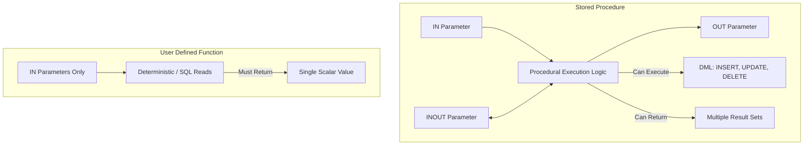
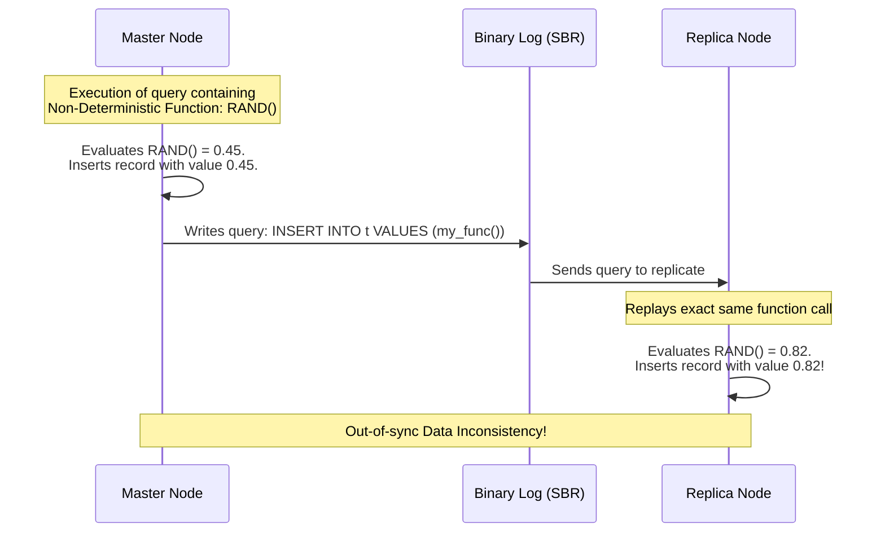

###  Sources
*   *Based on Images: 6, 11*

Subroutines are reusable procedural modules stored in the database catalog, divided into **Stored Procedures** and **User-Defined Functions (UDFs)**:



### 1. Stored Procedures
A block of code saved in the database that can encapsulate business logic. Stored procedures perform operational tasks, manage transactional boundaries, and modify database state:
*   **Transaction Control:** they can initiate, commit, or roll back database transactions (`START TRANSACTION`, `COMMIT`, `ROLLBACK`).
*   **Result Sets:** besides `OUT`/`INOUT` parameters, they can stream direct result sets back to the client application as dynamic grids.

**Parameters:**
1.  **`IN`:** Pass data **into** the procedure. (Default).
2.  **`OUT`:** The procedure sends data **back** to the caller.
3.  **`INOUT`:** The variable is passed in, modified, and sent back.

**Syntax:**
```sql
DELIMITER //  -- Change delimiter so ; doesn't end the creation early

CREATE PROCEDURE ProcessOrder (IN orderId INT, OUT total DECIMAL(10,2))
BEGIN
    SELECT SUM(price) INTO total 
    FROM order_items 
    WHERE order_id = orderId;
END //

DELIMITER ;
```

**Calling it:**
```sql
CALL ProcessOrder(101, @myTotal);
SELECT @myTotal;
```

---

### 2. SQL Functions (UDF)
Unlike procedures, functions **must** return a single value and can be used inline in SQL (`SELECT MyFunc(col)...`).

**Side-Effect Constraints:** to ensure query safety, functions cannot contain statements that modify database state or return active result sets:
*   **No transaction commands** — `START TRANSACTION`, `COMMIT`, `ROLLBACK` are prohibited inside a function.
*   **No DML on physical tables** — `INSERT`/`UPDATE`/`DELETE` on physical tables are generally prohibited, as are unassigned `SELECT` queries that would return row sets.

**Deterministic vs. Non-Deterministic:**
*   **DETERMINISTIC:** Same Input = Same Output. (e.g., `SQRT(4)` is always 2).
*   **NOT DETERMINISTIC:** Output varies. (e.g., `NOW()` changes every second, `RAND()` changes every call).

**SQL Data-Access Characteristics** — when compiling a function you must declare its execution behavior; this metadata helps the query optimizer make safe, performant decisions:
*   **`CONTAINS SQL`:** The function contains SQL statements but does not read or write data (e.g., executing `SELECT 1 + 1`).
*   **`NO SQL`:** The function contains no SQL code.
*   **`READS SQL DATA`:** The function reads data from tables (e.g., running `SELECT` queries) but does not modify it.
*   **`MODIFIES SQL DATA`:** The function executes DML statements (`INSERT`, `UPDATE`, `DELETE`) to modify tables.

#### The Binary Log Problem (Replication)

In distributed database setups using **Statement-Based Replication (`SBR`)**, the master server writes all executed SQL queries to a binary log (`binlog`); the standby (replica) servers then read and replay these queries to keep their data in sync:



If you use **Non-Deterministic** functions in an `INSERT`/`UPDATE`, and that query is replicated to a Slave server:
*   The Master might generate `RAND() = 0.5`.
*   The Slave might generate `RAND() = 0.9`.
*   **Result:** Data inconsistency — when the replica replays the statement, `RAND()` produces a different value, leaving master and replica out of sync.

To prevent this, MySQL enforces strict rules on function creation when binary logging is active:

```
Error 1418: This function has none of DETERMINISTIC, NO SQL, or READS SQL DATA in its declaration and binary logging is enabled (you *might* want to use the less safe log_bin_trust_function_creators variable)
```

**Solution:**
1.  **Explicit Declaration:** Mark functions as `DETERMINISTIC` if they are.
    ```sql
    CREATE FUNCTION CalculateTax(v_subtotal DECIMAL(10,2)) 
    RETURNS DECIMAL(10,2)
    DETERMINISTIC
    BEGIN
        RETURN v_subtotal * 0.20;
    END;
    ```
2.  **Trust Creators Override:** If you must deploy non-deterministic logic — or you are using **Row-Based Replication (`RBR`)**, which logs the resulting row values instead of the statement text and is therefore immune to the re-evaluation problem — enable `SET GLOBAL log_bin_trust_function_creators = 1;` in MySQL to bypass the safety check (use with caution).

---

### 3. Comparison Matrix: Stored Procedure vs. Stored Function

| Property | Stored Procedure | Stored Function (UDF) |
| :--- | :--- | :--- |
| **Execution Call** | Standalone statement via `CALL` | Embedded inside SQL expressions |
| **Return Mechanism** | Via zero or more `OUT`/`INOUT` parameters | Via a single scalar `RETURN` value |
| **DML Operations Allowed** | Yes (fully supported) | Restrictive (generally prohibited on physical tables) |
| **Result Sets** | Can return multiple active query grids | Prohibited (cannot return row sets) |
| **Transaction Control** | Can use `COMMIT` and `ROLLBACK` | Prohibited from executing transaction commands |
| **SQL Integration** | Cannot be used inside a `SELECT` statement | Fully integrated within `SELECT`, `WHERE`, `HAVING` |

---