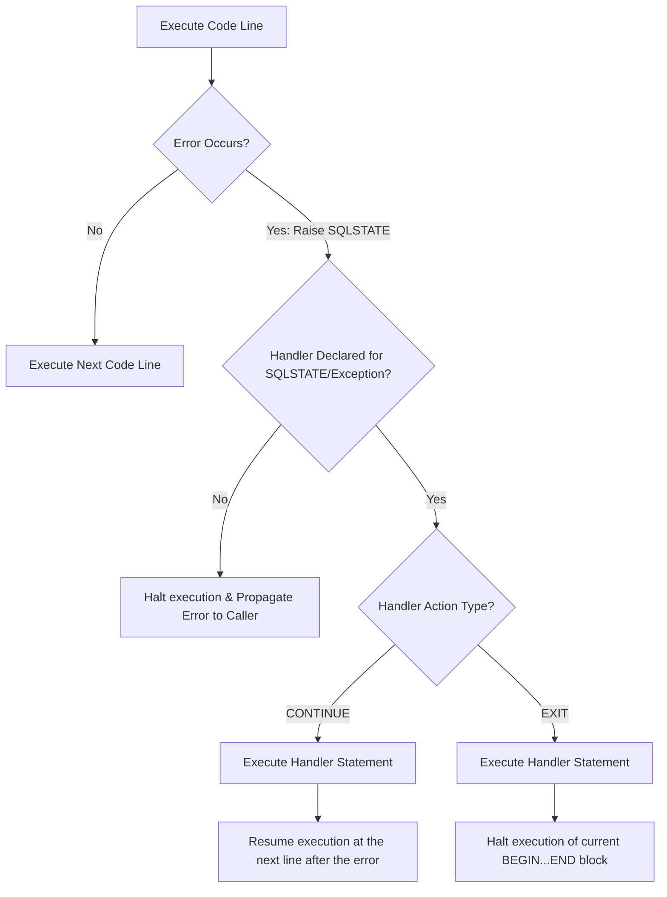

###  Sources
*   *Based on Images: 7, 9*

### 1. Sources of Errors
1.  **Constraint Violations:** Duplicate Primary Key, Foreign Key mismatch.
2.  **Data Errors:** Division by zero, Invalid type conversion.
3.  **Resource Issues:** Lock wait timeouts or connection losses.
4.  **Logical/Business Errors:** "Balance insufficient" (defined by your code).

### 2. Declaring Handlers
You can define what the procedure does when an error occurs. The full decision flow — whether a handler exists for the raised SQLSTATE, and whether it `CONTINUE`s or `EXIT`s — looks like this:



**Syntax:**
```sql
DECLARE [Action] HANDLER FOR [Condition] [Statement];
```

**Actions:**
*   **`CONTINUE`:** Log the error or set a flag, but continue executing the next line of code.
*   **`EXIT`:** Stop the procedure immediately (and perhaps Rollback).

**Conditions:**
*   `SQLWARNING`: Catches warning conditions (SQLSTATE classes starting with `01`).
*   `NOT FOUND`: Catches data-retrieval warnings (SQLSTATE classes starting with `02`) — commonly used to detect a cursor reaching the end of its dataset, or a `SELECT INTO` query returning no rows.
*   `SQLEXCEPTION`: Catches all database error conditions (SQLSTATE classes excluding those starting with `01` or `02`).
*   `SQLSTATE 'xxxxx'`: Catches a specific error code — e.g., SQLSTATE `'23000'` specifically handles integrity constraint violations.

### 3. Raising Errors (`SIGNAL`)
You can stop execution and throw a custom error to the application.

*   **`SIGNAL`:** Raises a new error.
    ```sql
    SIGNAL SQLSTATE '45000' SET MESSAGE_TEXT = 'Custom Error Message';
    ```
    Concrete business validation example — stop the withdrawal when funds are insufficient:
    ```sql
    IF v_balance < v_withdrawal_amount THEN
        SIGNAL SQLSTATE '45000'
        SET MESSAGE_TEXT = 'Insufficient Funds: Withdrawal amount exceeds current balance';
    END IF;
    ```
*   **`RESIGNAL`:** Used inside a Handler. It catches an error, does something (like logging), and then throws the error again so the caller knows it failed.
    ```sql
    DECLARE EXIT HANDLER FOR SQLEXCEPTION
    BEGIN
        -- 1. Roll back changes to keep data consistent
        ROLLBACK;
        -- 2. Log the failure to an audit table
        INSERT INTO error_log (log_time, error_desc) VALUES (NOW(), 'Transaction aborted');
        -- 3. Pass the exception back up to the calling application
        RESIGNAL;
    END;
    ```

> [!NOTE]
> SQLSTATE class `'45000'` is the industry standard code for user-defined, generic exceptions.

### 4. SQLSTATE Codes
Standardized 5-character codes.

| SQLSTATE Class Code | Meaning | Typical Scenario |
| :--- | :--- | :--- |
| **`00000`** | Success | Query executed with no issues |
| **`01000`** | General Warning | Data truncated during insert |
| **`02000`** | Not Found | Cursor has no more rows, or `SELECT INTO` returned nothing |
| **`23000`** | Integrity Constraint Violation | Duplicate key entered, or foreign key check failed |
| **`45000`** | Generic User-Defined Exception | Custom validation error thrown by `SIGNAL` business logic |

> [!PRO TIP] Procedure Structure with Handlers
> Always declare handlers at the *top* of your `BEGIN...END` block, after variable declarations but before any logic.

```sql
BEGIN
    DECLARE exit_flag INT DEFAULT 0;
    
    -- 1. Declare Variables
    -- 2. Declare Handlers
    DECLARE CONTINUE HANDLER FOR SQLEXCEPTION SET exit_flag = 1;
    
    -- 3. Start Transaction
    START TRANSACTION;
    
    -- 4. Logic
    UPDATE accounts...;
    
    -- 5. Check Errors
    IF exit_flag = 1 THEN
        ROLLBACK;
        SELECT 'Transaction Failed';
    ELSE
        COMMIT;
        SELECT 'Success';
    END IF;
END;
```

### 5. Complete Example: Validation + Transaction Handler (`RegisterBooking`)

A full worked procedure that applies the PRO TIP skeleton above to real logic — pre-validation with `SIGNAL`, an exception handler, and conditional commit/rollback:

```sql
CREATE PROCEDURE RegisterBooking(
    IN p_pilot_id INT, 
    IN p_flight_id INT,
    OUT p_status_msg VARCHAR(100)
)
BEGIN
    -- 1. Declare local state variables
    DECLARE v_already_booked INT DEFAULT 0;
    DECLARE v_tx_error INT DEFAULT 0;
    
    -- 2. Set up exception handlers
    -- If a database exception occurs, record the error and continue to the rollback phase
    DECLARE CONTINUE HANDLER FOR SQLEXCEPTION SET v_tx_error = 1;
    
    -- 3. Run validation checks before starting the transaction
    SELECT COUNT(*) INTO v_already_booked 
    FROM Bookings 
    WHERE pilot_id = p_pilot_id AND flight_id = p_flight_id;
    
    IF v_already_booked > 0 THEN
        SIGNAL SQLSTATE '45000'
        SET MESSAGE_TEXT = 'Pilot is already assigned to this flight.';
    END IF;
    
    -- 4. Start the transaction
    START TRANSACTION;
    
    -- Perform database updates
    INSERT INTO Bookings (pilot_id, flight_id, booking_date) 
    VALUES (p_pilot_id, p_flight_id, NOW());
    
    UPDATE Pilote 
    SET nbHVol = nbHVol + 2.50 
    WHERE brevet = p_pilot_id;
    
    -- 5. Commit or Roll Back based on the transaction status
    IF v_tx_error = 1 THEN
        ROLLBACK;
        SET p_status_msg = 'Transaction failed. All changes rolled back.';
    ELSE
        COMMIT;
        SET p_status_msg = 'Booking registered successfully.';
    END IF;
END;
```