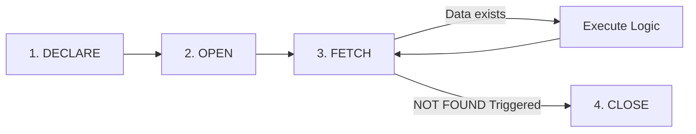

# Advanced Cursors and Dynamic SQL

Standard SQL is "set-oriented"—it processes thousands of rows at once. PL/SQL is "procedural"—it prefers to execute logic line by line. **Cursors** serve as the bridge between these two paradigms.

## 1. Implicit vs. Explicit Cursors

### Implicit Cursors
Every time you run an `INSERT`, `UPDATE`, `DELETE`, or a single-row `SELECT INTO`, the DBMS automatically creates an implicit cursor in the background to handle the execution state.
You can access metadata about the last executed implicit cursor using attributes:
*   `SQL%FOUND`: True if the query affected 1 or more rows.
*   `SQL%NOTFOUND`: True if no rows were affected.
*   `SQL%ROWCOUNT`: The number of rows affected.

### Explicit Cursors
For queries that return *multiple rows*, you must define an Explicit Cursor to iterate through the result set one row at a time.
1.  **DECLARE:** Define the query structure.
2.  **OPEN:** Execute the query and allocate memory (the Active Set).
3.  **FETCH:** Pull the next row from memory into local variables.
4.  **CLOSE:** Release the memory.



```plsql
DECLARE
    CURSOR emp_cursor IS SELECT name, salary FROM employees WHERE dept = 'IT';
    v_name employees.name%TYPE;
    v_salary employees.salary%TYPE;
BEGIN
    OPEN emp_cursor;
    LOOP
        FETCH emp_cursor INTO v_name, v_salary;
        EXIT WHEN emp_cursor%NOTFOUND; -- Exit loop when no more rows exist
        -- Do procedural logic here
    END LOOP;
    CLOSE emp_cursor;
END;
```

## 2. Advanced Cursor Control (`FOR UPDATE`)

If your cursor is iterating through rows with the intention of updating or deleting them, you must prevent other users from modifying those specific rows while your loop is running.

Adding the **`FOR UPDATE`** clause at the end of the cursor declaration places an **Exclusive Lock (X-Lock)** on the rows as soon as the cursor is opened.

```plsql
CURSOR salary_cursor IS 
    SELECT id, salary FROM employees WHERE status = 'Active' 
    FOR UPDATE;
```
Inside the loop, you can then update the exact row the cursor is currently pointing to using `WHERE CURRENT OF`:

```plsql
UPDATE employees SET salary = salary * 1.10 WHERE CURRENT OF salary_cursor;
```
This is much faster and safer than running `UPDATE employees ... WHERE id = v_id`.

> [!NOTE] MySQL Portability Warning
> MySQL does **not** natively support `WHERE CURRENT OF` (nor Oracle's `SQL%FOUND`-style cursor attributes). The same behavior is achieved by **fetching the primary key** into a variable during the `FETCH` and filtering the modification with `WHERE pk = v_pk` — this is exactly the pattern used by the `Gestion_Pilotes` procedure in *02 Functions and Stored Procedures*.

## 3. Dynamic SQL 
Standard PL/SQL requires queries to be hardcoded at compile time. But what if you want to write a procedure that can drop *any* table, where the table name is passed as a string variable?
You cannot write `DROP TABLE v_tableName;` because PL/SQL validators will look for a table literally named `v_tableName`.

**Dynamic SQL** allows you to build strings at runtime and tell the DBMS to compile and execute them.

Static SQL is fully defined when the code is compiled — the compiler checks that tables and columns exist, verifies data types, and generates an optimized execution plan ahead of time. Dynamic SQL defers all of that to runtime, which is what you need when database object names (like table or column names) are determined dynamically by user input or runtime conditions:

```mermaid
graph TD
    subgraph Compilation Phase
        StaticCode[Static SQL Checked at Compile Time]
    end
    subgraph Execution Phase (Runtime)
        DS_String[1. Build SQL String: 'UPDATE Table SET Col = ?']
        DS_Prep[2. PREPARE Statement from String]
        DS_Exec[3. EXECUTE Statement USING Bind Variables]
        DS_Dealloc[4. DEALLOCATE PREPARE to Free Memory]
        
        DS_String --> DS_Prep --> DS_Exec --> DS_Dealloc
    end
```

### `EXECUTE IMMEDIATE`
```plsql
CREATE PROCEDURE drop_dynamic_table (p_table_name VARCHAR2) IS
    v_sql_string VARCHAR2(200);
BEGIN
    -- Build the command string
    v_sql_string := 'DROP TABLE ' || p_table_name;
    
    -- Execute it dynamically
    EXECUTE IMMEDIATE v_sql_string;
END;
```

> [!WARNING] SQL Injection Warning
> Never use string concatenation (`||`) for user-input data in `EXECUTE IMMEDIATE` if it's a value comparison (`WHERE name = ` || user_input). Always use **Bind Variables** (`USING` clause) to prevent SQL Injection attacks.
> *Correct way:* `EXECUTE IMMEDIATE 'UPDATE emp SET salary = :1 WHERE id = :2' USING v_new_salary, v_id;`

### MySQL Dynamic SQL: `PREPARE` / `EXECUTE` / `DEALLOCATE PREPARE`

MySQL implements dynamic SQL with the `PREPARE`, `EXECUTE`, and `DEALLOCATE PREPARE` statements. Object names (like table names) cannot be parameterized with bind arguments, so they must be concatenated with `CONCAT` — while *values* are passed through `?` placeholders with `USING`:

```sql
CREATE PROCEDURE DeleteRowDynamic(IN p_table_name VARCHAR(64), IN p_row_id INT)
BEGIN
    -- 1. Build the SQL statement as a text string
    -- Note: Object names (like table names) cannot be parameterized using bind arguments.
    SET @v_sql = CONCAT('DELETE FROM ', p_table_name, ' WHERE id = ?');
    
    -- 2. Compile and optimize the statement string
    PREPARE stmt_dynamic FROM @v_sql;
    
    -- 3. Execute the statement, passing values into the parameter placeholders (?)
    SET @v_param_id = p_row_id;
    EXECUTE stmt_dynamic USING @v_param_id;
    
    -- 4. Clean up and free the compiled statement's memory
    DEALLOCATE PREPARE stmt_dynamic;
END;
```

### SQL Injection: Vulnerable vs. Secure (MySQL)

**Vulnerable code (high risk)** — untrusted input directly concatenated into the dynamic string:
```sql
-- Direct string concatenation is vulnerable to SQL injection
SET @v_sql = CONCAT('SELECT * FROM Users WHERE username = ''', p_user_input, '''');
PREPARE stmt FROM @v_sql;
EXECUTE stmt; -- If p_user_input is "admin' OR '1'='1", the execution plan is compromised!
```

**Secure code** — bind placeholders (`?`) + `USING`:
```sql
-- Parameterize values using '?' placeholders
SET @v_sql = 'SELECT * FROM Users WHERE username = ?';
PREPARE stmt FROM @v_sql;
SET @v_username = p_user_input;
EXECUTE stmt USING @v_username; -- Safely treated as a literal value, preventing injection
DEALLOCATE PREPARE stmt;
```
